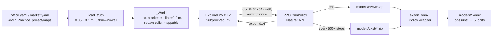
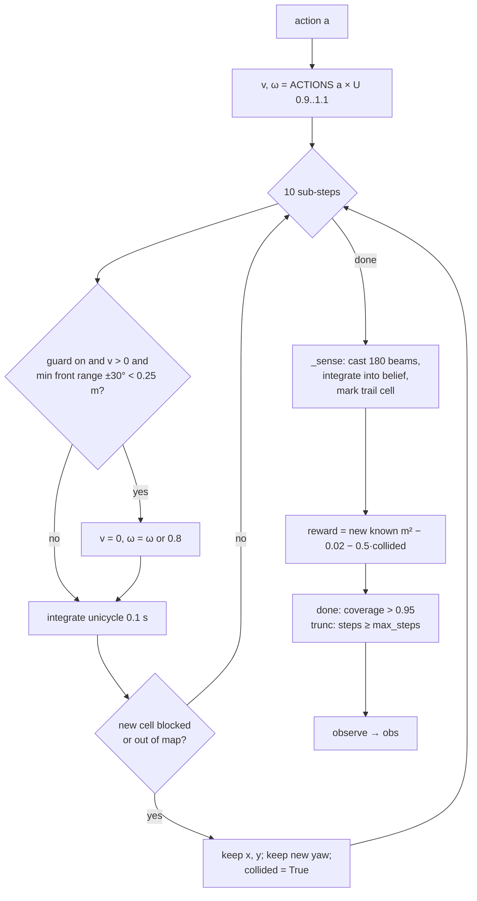
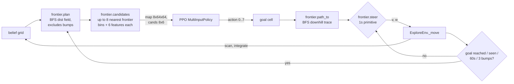
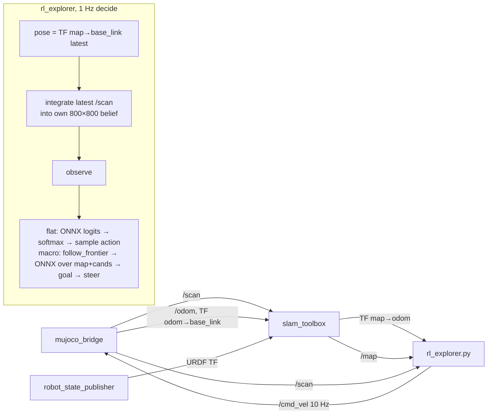

# AMR RL Mapping: technical reference for the refactor

This is a full description of the project **as it is now**: what every file and function does, why it
was built that way, how training and evaluation work, what the results are, and where the code has
shortcuts, duplication or bugs worth fixing in a refactor. It describes the code at the time of writing
(after model v3, the hierarchical/macro architecture); line-level details may drift as you change things.

---

## 1. What the project does

A differential-drive AMR (from `../AMR_Practice_project`) explores an unknown building and maps it
with `slam_toolbox`. The **driving decisions come from a PPO policy** trained with reinforcement
learning, instead of the hand-written frontier logic in that project's `lidar_explorer` node.

Two separate worlds are involved:

| | Training | Deployment / test |
|---|---|---|
| Simulator | own 2D grid sim (`rl/env.py`), numpy only | MuJoCo (`mujoco_bridge` from `AMR_Practice_project`) |
| Map | robot's own belief grid built by `integrate()` | the node's own belief grid (also `integrate()`), plus slam_toolbox's `/map` for the saved result |
| Speed | ~2 ms per step, 12 envs in parallel | real time, 1 decision per second |
| Runs on | host, Python 3.14 venv (`.venv`) | Docker container (`amr_rl`), ROS 2 Humble, Python 3.10 |

The link between them is an **ONNX file**: training exports the policy, and the ROS node runs it
with `onnxruntime`.

---

## 2. Repository layout and external dependencies

```
AMR_RL_Mapping/
├── README.md              user-facing overview, commands, results
├── PROJECT_DETAILS.md     this file
├── PLAN.md                original design plan (gitignored by you)
├── rl/                    training side (host)
│   ├── mapping.py         numpy-only core, also imported by the ROS node
│   ├── frontier.py        frontier candidates, BFS planner, path follower — shared by MacroExploreEnv,
│   │                      the greedy/random baselines, and the ROS node
│   ├── env.py             Gymnasium env (ExploreEnv, MacroExploreEnv) + self-check
│   ├── train.py           PPO training (flat or macro) + ONNX export
│   └── evaluate.py        PPO vs greedy vs random, metrics + plots
├── ros/                   deployment side (container)
│   ├── rl_explorer.py     ROS 2 node running the ONNX policy
│   ├── sim_test.sh        headless MuJoCo end-to-end run
│   ├── plot_runs.py       mapped-area-vs-time plot from sim_test.sh outputs
│   └── map_probe.py       debug: prints every /map message's arrival time and known area
├── models/                (gitignored) *.zip SB3 models, *.onnx exports, eval outputs, ckpt/
├── runs/                  (gitignored) training logs, sim_test.sh run folders
└── docs/                  (gitignored by you) plots and maps referenced by README.md
```

> ⚠️ Your `.gitignore` currently ignores `docs/` and `models/`. The README's images point into `docs/`,
> so they will be broken on GitHub. Either un-ignore `docs/` or remove the images from the README.

### Things outside this repo the code depends on

| Dependency | Where it is used | How it is found |
|---|---|---|
| `~/projects/AMR_Practice_project/src/amr_bot/maps/{office,market}.{yaml,pgm}` | ground truth for the 2D sim | `env.MAPS_DIR`, override with env var `AMR_MAPS` |
| `amr_bot` package (built in `/ros2_ws/install`): `mujoco_bridge`, `rsp.launch.py`, `lidar_explorer`, `office_scene.xml`, `async_slam_toolbox_cfg.yaml` | MuJoCo tests | hard-coded container paths in `sim_test.sh` and the README |
| Docker image `amr_rl:base` (= `docker commit amr`) + `pip install onnxruntime` | ROS side | README setup |
| Host Python packages: torch (CPU), gymnasium, stable-baselines3, onnx, onnxruntime, matplotlib | training/eval | `.venv`, no `requirements.txt` yet |

---

## 3. Conventions used everywhere

These are implicit contracts; breaking any of them silently breaks the policy.

| Convention | Value | Where it matters |
|---|---|---|
| Grid indexing | `grid[row, col]`, `row = floor((y − origin_y) / RES)`, `col = floor((x − origin_x) / RES)` (same as `nav_msgs/OccupancyGrid`) | all of `mapping.py`, `env._cell`, node trail |
| Resolution | `RES = 0.1` m per cell (SLAM uses 0.05; the truth maps are downsampled 2×) | everything |
| Belief values | `int8`: `-1` unknown, `0` free, `1` occupied (`UNKNOWN, FREE, OCC`) | `integrate`, `observe`, `frontier`, evaluator |
| Truth map | `bool` grid, `True` = occupied; **unknown in the PGM counts as occupied** | `load_truth` |
| Pose | `np.array([x, y, yaw])` in the map frame, yaw in rad | everywhere |
| Lidar angles | relative to robot heading; 0 = straight ahead, counter-clockwise positive | `cast`, `integrate`, the node |
| Real `/scan` layout | 360 beams, 1°, index 0 = behind, **index 180 = straight ahead**, 0.1–10 m, no return = `inf` | node guard (`mid ± 30`) |
| Actions | index → `(v m/s, ω rad/s)`: `0` forward `(0.2, 0)`, `1` arc left `(0.2, 0.6)`, `2` arc right `(0.2, −0.6)`, `3` rotate left `(0, 0.8)`, `4` rotate right `(0, −0.8)` | `env.ACTIONS`, **duplicated** in `rl_explorer.ACTIONS` and hard-coded indices in `frontier_policy` |
| Decision period | `DT = 1.0` s | `env.DT`, **duplicated** in node |
| Observation | `uint8 (8, 64, 64)`, values 0/255; channel order per scale `[free, occupied, visited, frontier]`, scales `[local, global]` → channels 0–3 local, 4–7 global | `observe`, ONNX input, node channel slicing |
| Observation orientation | robot at crop centre, **row 0 = ahead, col 0 = left** | `observe` |

---

## 4. Architecture

### 4.1 Training pipeline



### 4.2 One environment step



### 4.3 Hierarchical ("macro") architecture — v3

v1/v2 had the policy output one of 5 motion primitives directly, every second, for the whole episode.
It never learned "this area is done, go far away" reliably (§8.1). v3 restructures the decision: the
policy chooses **which frontier to go to** (one of up to 8 candidates), and a shared BFS planner +
path follower drives there. One policy decision now covers 5-60 s of robot time instead of 1 s.



`frontier.py` is the one module used by **training** (`MacroExploreEnv`), **evaluation**'s greedy and
random baselines, and the **ROS node** (`follow_frontier`) — the policy picks among exactly the same
candidates and drives with the same executor everywhere. See §9 (problem 10) for a bug found in this
shared planner that only shows up in real SLAM deployment, not in the clean 2D sim.

### 4.4 Deployment (ROS)



The node **does not feed SLAM's `/map` to the policy** (see §9, problem 2). `/map` is only used to
log the mapped area, and slam_toolbox's map is what `map_saver_cli` saves.

`self.macro = len(onnx inputs) > 1` auto-detects which mode a loaded model needs, so the same node
script runs both v1/v2 (flat) and v3 (macro) models.

---

## 5. Module reference

### 5.1 `rl/mapping.py` — numpy-only core (shared by sim and ROS node)

Must stay importable on Python 3.10 + numpy 1.26 (the container) **and** Python 3.14 + numpy 2.x (host).
No torch, no gymnasium, no cv2.

| Name | Signature | What it does | Notes / gotchas |
|---|---|---|---|
| `RES` | `0.1` | metres per cell | changing it changes the observation scale → retrain |
| `CROP` | `64` | observation crop side, px | |
| `SCALES` | `(1, 8)` | cells per observation pixel for each crop: 0.1 m/px (6.4 m window) and 0.8 m/px (51.2 m window) | |
| `UNKNOWN, FREE, OCC` | `-1, 0, 1` | belief codes | |
| `MAX_RANGE` | `10.0` | lidar range, m | matches the real lidar and `max_laser_range` in SLAM |
| `_D` | `arange(0, 10, 0.05)` | ray sample distances (200 samples, half a cell apart) | shared by `cast` and `integrate` |
| `N_CHANNELS` | `4 * len(SCALES)` = 8 | observation channels | |
| `load_truth(yaml_path)` | → `(occ: bool[H,W], origin: ndarray[2])` | parses a map_server YAML by hand, reads the PGM, flips it vertically (PGM row 0 is max y), downsamples by `k = RES/src_res` with "free only if **all** k×k source pixels are > 250", returns `~free` as occupied | parses YAML with string splitting (no PyYAML); ignores `negate`, thresholds and origin yaw; unknown (205) becomes wall |
| `_read_pgm(path)` | → `uint8[H,W]` | minimal binary P5 reader, skips `#` comments | asserts P5; assumes maxval < 256 |
| `dilate(mask, r_cells)` | → `bool[H,W]` | binary dilation with a disk by OR-ing shifted copies | O(r²·H·W); fine for r ≤ 3 |
| `flood(free, seed)` | → `bool[H,W]` | 4-connected component containing `seed` by repeated 1-cell growth until no change | O(diameter·H·W); a few hundred iterations on the office, ~0.1 s |
| `_ray_cells(origin, pose, angles, shape)` | → `(r, c, inside)` each `[n_beams, 200]` | grid cells sampled along each ray | out-of-map samples are clipped and flagged `inside=False` |
| `cast(occ, origin, pose, angles=180 beams)` | → `(angles, ranges)` | simulated lidar: first occupied sample along each ray; `inf` if none within 10 m | sim only; default 180 beams at 2° (real lidar has 360 at 1°); the default array is evaluated once at import (fine because it's never mutated) |
| `integrate(belief, origin, pose, angles, ranges)` | in-place | cells before the return → `FREE`; the return cell → `OCC` (only if `range < MAX_RANGE`); `inf`/`nan` → free out to 10 m; beams outside the grid are skipped | **the one function shared by sim and robot**; free is written before occupied, so a ray never erases its own hit, but a later ray **can** overwrite an earlier OCC cell with FREE (grazing) |
| `_any_pool(mask, k)` | → `bool[H/k, W/k]` | k×k "any" downsample | trims edges that don't fill a full block |
| `frontier(belief)` | → `bool[H,W]` | free cells with a 4-neighbour unknown; edges padded as known | different from `evaluate.frontier_policy`'s own frontier, which uses `np.roll` (wraps around the map edge) |
| `observe(belief, trail, origin, pose)` | → `uint8[8, 64, 64]` | for each scale: pool the 4 layers (free, occ, trail, frontier) with `_any_pool`, then nearest-neighbour sample a 64×64 grid rotated to the robot's heading; outside the map → 0 | recomputes `frontier()` and all pooling on the **whole** map every call (~1 ms office, more on the node's 800×800 grid) |

### 5.2 `rl/frontier.py` — frontier candidates, BFS planner, path follower

numpy + stdlib only (like `mapping.py`). Shared by `MacroExploreEnv`, `evaluate.py`'s greedy/random
baselines, and `rl_explorer.py`'s `follow_frontier`, so all three choose among identical candidates
and drive with an identical executor.

| Name | Value / signature | What it does | Notes / gotchas |
|---|---|---|---|
| `K` | `8` | candidates offered to the policy, nearest first; slot 0 = greedy nearest frontier | |
| `N_FEAT` | `6` | per-candidate features: valid, path length, forward offset, left offset, frontier-cell-group size, nearby unknown area | |
| `BIN` | `10` cells (1 m) | one candidate per 1 m × 1 m bin of frontier cells, so nearby frontier cells don't flood all 8 slots | |
| `GAIN_BINS` | `2` | unknown-area feature is summed within ±2 bins (5 m × 5 m) of the candidate | |
| `MIN_DIST` | `5` cells | ignore frontier cells the robot is already standing on | |
| `REACHED` | `3` cells | Manhattan distance counted as "goal reached" | |
| `plan(belief, bumps, start)` | → `dist: int32[H,W]` (`-1` unreachable) | BFS path length through known free space, excluding `bumps` (treated like a wall via `dilate(occ \| bumps, 3)`). Tries a 0.3 m clearance margin first, falls back to 0.2 m (the collision radius) if that leaves no frontier reachable — same escalation idea as the old `frontier_policy` baseline | **permanently** excludes any cell ever added to `bumps`, for the rest of the episode, unless the caller's retry loop clears the whole blacklist (see problem 10, §9) |
| `_bfs(trav, safe, start)` | → `dist` | 4-connected BFS over a flat list (faster than numpy scalar indexing); the robot's own 7×7 "escape zone" is always walkable if `safe`, so it can leave inflation/doorway margins | |
| `_bin_sum(mask, k)` | → `int32[H/k, W/k]` | block-sum downsample, used for the unknown-area feature | |
| `candidates(belief, dist, pose, origin)` | → `(goals int[n,2], feats float32[K, 6])` | groups frontier cells into 1 m bins, keeps the nearest cell per bin, returns up to `K` candidates sorted by path distance | `n` can be 0 (nothing reachable); callers must handle it |
| `is_frontier(belief, cell)` | → `bool` | single-cell check: free, with an unknown 4-neighbour | |
| `path_to(dist, goal)` | → `int[n,2]` | traces from goal back to the robot by following `dist` downhill one 4-neighbour step at a time | |
| `steer(pose, path, origin, lookahead=6)` | → action index `0..4` | same primitive scheme as `env.ACTIONS`: rotate if heading error > 0.6 rad, arc if > 0.15 rad, else forward, toward the path point 6 cells ahead of the closest one | |

### 5.3 `rl/env.py` — Gymnasium environment

Module constants:

| Name | Value | Meaning |
|---|---|---|
| `MAPS_DIR` | `$AMR_MAPS` or `~/projects/AMR_Practice_project/src/amr_bot/maps` | where truth maps live |
| `MAPS` | `{'office': 'office.yaml', 'market': 'market.yaml'}` | map names → YAML |
| `DT` | `1.0` | seconds per action |
| `ACTIONS` | 5×2 array, see §3 | |
| `FRONT` | `radians(arange(-30, 31, 5))` (13 beams) | guard cone |
| `STOP_DIST` | `0.25` | guard distance, m (= node `stop_dist`) |
| `ROBOT_R`, `MARGIN` | `0.15`, `0.05` | collision inflation = `ceil(0.2 / 0.1)` = 2 cells |

**`class _World(yaml_path)`** — per-map static data, built once per env instance:

| Attribute | How it is built |
|---|---|
| `occ`, `origin` | `load_truth` |
| `blocked` | `dilate(occ, 2)`: cells the robot centre may not enter |
| `spawn` | `argwhere` of the **largest** 4-connected component of `~blocked` (found by flooding from the first unvisited free cell repeatedly) |
| `mappable` | number of cells in the un-inflated free component containing `spawn[0]`: the denominator of coverage |

Construction cost: ~0.3–0.7 s per map (repeated `flood`). With `SubprocVecEnv` every one of the 12
workers builds both worlds.

**`class ExploreEnv(gym.Env)`**

`__init__(maps=('office','market'), max_steps=1000, seed=None, pre_explore=0.0, guard=True)`
- `observation_space = Box(0, 255, (8, 64, 64), uint8)`, `action_space = Discrete(5)`.
- `self.np_random` is a numpy `Generator` (overwritten by `reset(seed=…)`).

State held between steps: `w` (current `_World`), `pose`, `belief` (`int8`, full map size), `trail`
(`bool`), `known` (count of non-unknown cells), `steps`, `collisions`.

| Method | Behaviour |
|---|---|
| `reset(seed=None, options=None)` | picks a world uniformly, a spawn cell uniformly, random heading (or `options['pose']`); clears belief and trail. With probability `pre_explore`: picks radius R ∈ U(3, 15) m, takes spawn cells within R of the start, and integrates scans from 2–12 random ones (heading 0) into the belief, marking each in the trail. Then `_sense()` once. Returns `(obs, {})`. |
| `step(a)` | §4.2. Returns `(obs, reward, done, trunc, {'coverage', 'collisions'})` |
| `_sense()` | `integrate(cast(...))` at the current pose, updates `known`, marks the trail cell, returns new known area in m² |
| `_cell(pose)` | `(row, col)` with `int()` truncation (not floor: wrong for negative offsets, which only happen outside the map) |
| `_obs()` | `observe(belief, trail, origin, pose)` |
| `coverage()` | `count(belief == FREE) / mappable` |

Self-check (`python env.py`): builds both worlds, asserts the first observation has free space and
frontiers, asserts a pre-explored start reveals more map, runs 300 random steps, asserts the robot is
never inside `blocked`, prints ms/step.

Details worth knowing:
- **Reward uses known cells (free + occupied); coverage and the done condition use free cells only.**
- Collision is checked on the **cell of the robot centre** against `blocked`; rotation is never blocked.
- The guard casts 13 beams **every sub-step while v > 0** (up to 10 casts per step); this is most of the
  slowdown from ~1.7 ms to ~2.2 ms per step.
- `done` at 95% coverage can be unreachable from some spawns (cells only visible from tight spots), so
  most episodes end by truncation.
- Truncation is passed correctly as `truncated`; SB3's on-policy rollout bootstraps from the last
  observation for time-limit truncations, so the value target is not cut off.

**`class MacroExploreEnv(ExploreEnv)`** — the v3 hierarchical env (§4.3).

`__init__(max_macro_s=60, **kw)` passes everything else to `ExploreEnv.__init__`.
`observation_space = Dict({'map': Box(0,255,(8,64,64),uint8), 'cands': Box(-inf,inf,(8,6),float32)})`,
`action_space = Discrete(8)` (= `K` in `frontier.py`).

Extra state: `self.bumps` (`bool[H,W]`, reset to all-`False` in `reset()`, **never cleared during an
episode except by the retry loop below**), `self.dist` (BFS field from the last `_macro_obs`),
`self.goals`/the cached `feats` (candidates for the current decision).

| Method | Behaviour |
|---|---|
| `_macro_obs()` | `self.dist = plan(belief, bumps, cell)`; `self.goals, feats = candidates(...)`. If no candidates come back **and** `bumps` is non-empty, clears `bumps` entirely and retries once. Returns `{'map': self._obs(), 'cands': feats}` |
| `reset(...)` | calls `ExploreEnv.reset`, zeroes `bumps`, returns `_macro_obs()` |
| `step(a)` | picks `goal = self.goals[min(a, len(goals)-1)]` (so an out-of-range action index degrades to the farthest valid candidate, never crashes), traces `path_to(dist, goal)`, then runs up to `max_macro_s` 1 s primitives via `steer()` + `_move()`, summing their rewards. Stops early on: 1000-step cap, 95% coverage, 3 bumps since this macro-step began, within `REACHED` cells of the goal, or the goal cell is no longer a frontier (something else saw it first). A bump marks the cell just ahead of the robot in `bumps`. If the whole macro-step made **zero** progress in known-cell count and the goal is still nominally a frontier, the goal cell itself is also blacklisted into `bumps` — this is the "stuck against a goal" escape hatch, and the mechanism behind problem 10 (§9). `done` is coverage > 0.95 **or `len(self.goals) == 0`** (no reachable frontier left, by this env's own bookkeeping) |

Self-check: none dedicated; `ExploreEnv`'s `__main__` block only exercises the flat env.

### 5.4 `rl/train.py` — training and export

| Name | What it does |
|---|---|
| `OUT = '../models'` | output dir, **relative to the working directory**: the script must be run from `rl/` |
| `class _Policy(nn.Module)` | wraps an SB3 policy into `obs → logits`: `extract_features(obs, pi_features_extractor)` (which itself casts to float and divides by 255) → `mlp_extractor.forward_actor` → `action_net`. Value head is dropped. `forward(*inputs)` accepts either one positional tensor (flat models) or several (macro models, zipped back into the `Dict` observation by `observation_space.spaces` key order: `map`, `cands`), so the same wrapper exports both. |
| `export_onnx(model, path)` | moves the policy to CPU, eval mode. For a `Dict` observation space, builds one dummy tensor per key (`uint8` for `map`, `float32` for `cands`) and names the ONNX inputs after the dict keys; otherwise one `uint8` dummy named `obs`. Exports with the legacy exporter (`dynamo=False`); batch dimension fixed at 1. `rl_explorer.py` and `evaluate.py` both detect macro vs. flat models by **counting the ONNX session's inputs** (`len(inputs) > 1`), so this naming/arity is a load-bearing contract, not just a label. |
| `__main__` | `python train.py model.zip` → export only (mode inferred from the loaded model's observation space). Otherwise `python train.py [steps] [name] [macro]`: `macro` picks `MacroExploreEnv` + `MultiInputPolicy`; omitting it trains the flat `ExploreEnv` + `CnnPolicy`. Both checkpoint periodically to `models/ckpt/NAME_<steps>_steps.zip`, then final save + export. |

PPO configuration:

| Setting | Flat (v1/v2) | Macro (v3) | Note |
|---|---|---|---|
| policy | `CnnPolicy` (NatureCNN, 512 features, shared extractor) | `MultiInputPolicy` (NatureCNN on `map` + MLP on `cands`, concatenated) | |
| envs | 12 × `SubprocVecEnv`, `seed=0` | same | |
| `n_steps` | 256 (rollout 3072) | 128 (rollout 1536) | one macro step is 5-60 s of robot time, so far fewer decisions per episode; a shorter rollout keeps update frequency reasonable |
| `batch_size` / `n_epochs` | 512 / 4 | 256 / 4 | |
| `learning_rate` | 2.5e-4, constant | same | |
| `gamma` / `gae_lambda` | 0.995 / 0.95 | 0.99 / 0.95 | macro episodes are much shorter in *decision* count, so less discounting is needed to see far enough ahead |
| `clip_range` | 0.1 | same | |
| `ent_coef` | 0.01 | same | |
| checkpoint interval | every 500k steps | every 50k steps | matches the shorter macro rollout/episode scale |
| env kwargs | `pre_explore=0.5`, `max_steps=1000`, `guard=True` (all default) | same | |

> **The v2 model was trained before the guard was added to `ExploreEnv`.** v3 (macro) was trained
> with the guard on from the start, so it is the first fully guard-consistent model.

Throughput (flat, v2): ~650–800 env steps/s total on a 16-core laptop CPU (the network update
dominates, not the env); 3M steps ≈ 65–80 min. Macro (v3) decisions are much more expensive each
(up to 60 env sub-steps), so wall-clock per training step is higher despite the smaller network input;
v3's best checkpoint so far came from ~100k macro steps.

### 5.5 `rl/evaluate.py` — evaluation and baselines

| Name | What it does |
|---|---|
| `MAX_STEPS = 1000` | evaluation horizon, s |
| `_sample(env, logits)` | softmax over logits, `env.np_random.choice` (seeded, reproducible) |
| `ppo_policy(path)` | loads an ONNX file, inspects `sess.get_inputs()`: more than one input → `(MacroExploreEnv, act)` feeding `{'cands': ..., 'map': ...}`; one input → `(ExploreEnv, act)` feeding `{'obs': ...}` with v1's 6→8 channel slicing (`[0,1,2,4,5,6]`) if needed. Either way `act` **samples**, never argmax (argmax collapsed the flat policy to "forward" against a wall). |
| `greedy_policy(env, obs)` | always action `0` = `MacroExploreEnv`'s nearest frontier candidate — this **is** the classic frontier explorer now, since `MacroExploreEnv` already does the BFS plan + path-follow; no separate baseline implementation needed |
| `random_frontier_policy(env, obs)` | uniform over `len(env.goals)` (falls back to 1 if none) |
| `run(env, policy, seed)` | one episode: reset with `seed`, step until done or 1000 steps, returns `(coverage curve padded to 1001, trajectory, collisions)` |
| `__main__` | `python evaluate.py model.onnx [n=5]`: for office and market, runs `ppo` (on whichever env class the model needs), `greedy`, and `random` on seeds `1000…1000+n−1` (same spawns for all three), prints/saves a summary, a coverage plot, and one replayed PPO episode per map |

The old hand-rolled `frontier_policy` baseline (separate BFS, separate bump/stall tracking) is
**gone**: `MacroExploreEnv` + `greedy_policy` now plays that role exactly, using the same `frontier.py`
planner the trained policy and the robot use — so "PPO vs. the classic frontier explorer" is really
"PPO vs. always picking candidate slot 0" on an otherwise identical env.

Metrics printed per (map, policy):

| Metric | Definition |
|---|---|
| `final cov` | mean ± std of coverage at 1000 s (curves padded with their last value after `done`) |
| `cov@300s` | mean coverage at step 300 |
| `reached 90%` | episodes whose coverage reached 0.9 |
| `t90 median` | median first step with coverage ≥ 0.9, over episodes that reached it |
| `collisions` | mean collision count (sub-step collisions are counted once per step) |

Outputs (`<model path without .onnx>_…`): `_eval.txt`, `_coverage.png`, `_office_episode.png`, `_market_episode.png`.

Runtime: ~2 min for 10 episodes × 3 policies × 2 maps; the frontier BFS is the slowest (~2–6 s per office episode).

### 5.6 `ros/rl_explorer.py` — ROS 2 node

Imports `mapping` by inserting `../rl` into `sys.path` (so it must live next to `rl/`).

Parameters: `model` (default `/rl/models/ppo_explore.onnx`), `max_time_s` (900.0, **must be a
float literal** on the command line), `stop_dist` (0.25).

| Member | Behaviour |
|---|---|
| `__init__` | loads ONNX; `self.inputs = [i.name for i in sess.get_inputs()]`, `self.macro = len(self.inputs) > 1` (v3 models take `map` + `cands`). For flat models, reads channel count: if 6 (v1), uses channels `[0,1,2,4,5,6]` of the 8-channel observation, else all. Allocates an 800×800 belief, trail, and (macro only) `bumps` grid covering ±40 m around the **map origin** (`HALF = 40`). Macro-mode state: `self.goal, self.path, self.goal_t, self.goal_known, self.complete`. Subscribes `/map` (transient local, reliable, depth 1) and `/scan` (depth 10, just stores the latest). Timers: `decide` at 1 Hz, `drive` at 10 Hz. |
| `on_map(m)` | stores `count(data != -1) × res²` (same metric as `lidar_explorer`'s log) |
| `pose()` | latest TF `map → base_link` (`Time()` = most recent), returns `[x, y, yaw]`; warns every 5 s until TF exists |
| `decide()` | needs pose and a scan. Logs mapped area every 10 s (wall clock). After `max_time_s`, sets the command to zero and logs `exploration finished` once. Otherwise: converts the latest scan to angles (`angle_min + i·increment`), drops beams below `range_min`, `integrate`s at the current pose, marks the trail cell (bounds-checked — see §9, problem 7 fix), builds the observation, then **flat**: runs ONNX, samples an action directly; **macro**: calls `follow_frontier(p, cell, obs, now)`, which returns a primitive index or `None` (stop). |
| `sample(feed)` | `sess.run(None, feed)[0][0]` → softmax → `np.random.choice`, shared helper for both modes |
| `follow_frontier(p, cell, obs, now)` | mirrors `MacroExploreEnv.step`: if a goal is active and not timed out (60 s)/reached/no-longer-a-frontier, keep steering toward it. Otherwise: if the goal made no progress (known-cell count unchanged) and is still a frontier, blacklist it into `self.bumps`; re-plan via `frontier.plan`/`frontier.candidates` (with the same "clear bumps once if nothing comes back" retry as the env); if still nothing, set `self.complete = True`, log `exploration complete: no reachable frontier left`, and stop for good (never re-checked again, even though time budget may remain). Otherwise sample a new goal from the policy over `{'cands', 'map'}` and start steering toward it. **This is the exact mechanism behind the deployment bug in §9, problem 10.** |
| `drive()` | publishes `self.cmd` on `/cmd_vel`; if `v > 0` and any finite beam in indices `mid−30 … mid+30` of the latest scan is between `range_min` and `stop_dist`, publishes `(0, ω or 0.8)` instead |
| `main()` | `rclpy.init(signal_handler_options=NO)` so that after Ctrl-C the context still exists to publish a zero `Twist`, then shuts down |

Things to know:
- The time base is **wall clock** (`time.monotonic()`), not ROS time; there is no `/clock` in the MuJoCo setup.
- The scan is integrated at the **latest** TF pose, not at the scan's timestamp (up to ~0.1 s and ~0.08 rad of skew while rotating).
- Only **one scan per second** is integrated (the most recent), matching the sim's one scan per step.
- **Bug:** if the robot goes more than 40 m from the map origin, `self.trail[r, c] = True` raises
  `IndexError` (no bounds check; `integrate` itself is safe). Not reachable in the office, which spans about ±25 m.
- The guard cone is defined by **beam index** (assumes 1° beams and index 180 ahead); the sim's guard is
  defined by **angle** (±30°, 13 beams). Same intent, two implementations.

### 5.7 `ros/sim_test.sh` — headless MuJoCo test

`sim_test.sh rl|frontier SECONDS [model.onnx]`, run inside the container.
1. Output folder `/rl/runs/sim_<explorer>_<HHMMSS>/`.
2. Sources ROS, sets `LIBGL_ALWAYS_SOFTWARE=1`, unsets `DISPLAY` (bridge runs without a viewer),
   `ROS_DOMAIN_ID=42` unless already set.
3. Starts `mujoco_bridge` (office), `rsp.launch.py`, `slam_toolbox`, each with `setsid` so each is its own process group; remembers the PIDs.
4. `sleep 8`, then starts the explorer (`rl_explorer.py` with `max_time_s=SECS.0`, or `lidar_explorer`).
5. `sleep SECS`, saves the map with `map_saver_cli`.
6. SIGINT to each process group, `sleep 3`, SIGKILL to each process group, prints the last log lines, `chown`s the folder to the owner of `/rl`.

It only kills its own process groups, so it can run next to an interactive sim (tested with decoy
processes named `mujoco_bridge` and `rl_explorer.py`).

### 5.8 `ros/plot_runs.py` and `ros/map_probe.py`

- `plot_runs.py out.png LABEL=folder …`: parses `[timestamp] … mapped area: X` lines from each
  folder's `explorer.log` and plots area vs seconds since the first line.
- `map_probe.py`: subscribes to `/map` and prints the arrival time and known area of every message.
  Used to diagnose problem 2 (§9).

---

## 6. Methodology: why it is built this way

### 6.1 Train in 2D, test in MuJoCo

MuJoCo + SLAM runs in real time with one decision per second; 3M decisions would take about 35 days.
The 2D sim is about 500× faster per env and parallelises. Fidelity choices:

| Real robot | 2D sim | Gap |
|---|---|---|
| MuJoCo office / supermarket | the SLAM maps the robot saved earlier, at 0.1 m | maps are SLAM output (slightly noisy walls, unknown = wall) |
| 360 beams, 1° | 180 beams, 2° | sim sees fewer thin obstacles; fan streaks differ |
| diff drive with wheel PI loop, caster | ideal unicycle, ±10% speed noise | no acceleration limits or slip |
| SLAM pose (drifts) | exact pose | node's belief can blur with SLAM drift |
| lidar guard in node | same guard in env (since after v2 training) | cone defined by angle vs by index |

### 6.2 Observation design

- **Egocentric and rotated:** the same action always means the same thing relative to the picture
  (forward = up), so the CNN doesn't have to learn rotation.
- **Two scales:** 6.4 m at full resolution for obstacles near the robot, 51 m at 0.8 m/px for "where is
  unexplored space in the building". Max-pooling ("any") keeps thin walls visible at the coarse scale.
- **Channels:** free, occupied (unknown is implicit: neither), visited trail (to avoid loops),
  frontier (added in v2 to make "where to go next" explicit after coarse pooling).
- **Robot's own map only.** No ground truth, no SLAM map (see problem 2).

### 6.3 Action design

Five discrete (v, ω) primitives held for 1 s, at the limits `lidar_explorer` uses (0.2 m/s, 0.8 rad/s).
Discrete + held is simple for PPO and makes the 1 Hz decision rate natural. Cost: motion is jerky, and
the robot cannot turn and drive at arbitrary ratios.

### 6.4 Reward

`r = Δknown_area_m² − 0.02 − 0.5·collided`. Dense and directly what we want. The −0.02 per step
encourages finishing; −0.5 discourages bumping (weakly: the policy still collides 60–160 times per
1000 s in the sim). There is no explicit reward for reaching frontiers or for leaving finished areas,
which is why that behaviour is learned poorly (§8).

### 6.5 Exploration-phase curriculum (v2)

`pre_explore=0.5`: half of the episodes start with a 3–15 m area around the spawn already mapped, so
the policy often faces "nothing new nearby, go elsewhere". This was the fix for v1 staying in rooms
it had already mapped.

### 6.6 Stochastic execution

Actions are sampled from the softmax over logits, both in evaluation and on the robot. PPO is trained
on a stochastic policy; its argmax collapsed to "forward" (98%) and pinned the robot to a wall.

### 6.7 Hierarchical ("macro") action space (v3)

v1/v2's "leaves finished rooms" problem (§8.1) comes from a 1 s decision horizon: the dense per-step
reward never has to justify the many seconds of "cross the empty room you've already mapped" that
precede any new area. Option considered and rejected: shape the reward with a potential term toward
the nearest frontier (adds another hyperparameter and still leaves a flat action space to explore).
Option chosen: make the **decision itself** long-horizon — the policy picks *which frontier*, not
*which wheel speeds* — and delegate the mechanical part (don't bump things, follow the path) to the
same BFS planner used everywhere else in the project (`frontier.py`, §5.2). This:
- removes the credit-assignment problem (a frontier choice is directly rewarded by the area gained
  while reaching it, over however many seconds that takes);
- makes "go somewhere else" a single action instead of a sequence the network has to discover;
- reuses, rather than relearns, mechanical obstacle avoidance and path following that classic frontier
  exploration already solves well (the `greedy` baseline in `evaluate.py` IS this planner, slot 0).

Measured effect in the clean 2D sim (§8.2): **all 20 test episodes** (10 office + 10 market) reach
≥90% coverage under PPO, greedy, *and* random frontier choice — something that never happened with
v1/v2's flat action space. The architecture change fixes the "stuck in a finished room" failure mode
outright. What it does *not* yet establish: that the *learned* choice of which frontier to visit
first is better than simply picking the nearest one (§8.2) — and in real SLAM deployment, a different
failure mode shows up that the noiseless 2D sim never exercises (§8.4, §9 problem 10).

---

## 7. Procedures

### 7.1 Training

```bash
cd ~/projects/AMR_RL_Mapping/rl                     # required: OUT is relative
mkdir -p ../models ../runs
# flat (v1/v2-style):
setsid nohup ../.venv/bin/python -W ignore train.py 3e6 ppo_explore_v2 > ../runs/train_ppo_explore_v2.log 2>&1 &
# macro / hierarchical (v3): same script, trailing "macro" switches env + policy class (§5.4)
setsid nohup ../.venv/bin/python -W ignore train.py 3e6 ppo_macro_v3 macro > ../runs/train_ppo_macro_v3.log 2>&1 &
grep -E "total_timesteps|ep_rew_mean" ../runs/train_ppo_macro_v3.log | tail -2       # progress
../.venv/bin/python -W ignore train.py ../models/ckpt/ppo_macro_v3_99984_steps.zip   # export a checkpoint
```
`ep_rew_mean` is not comparable between versions (different episode length/horizon, starts and guard,
and — flat vs. macro — a completely different meaning of "one step").

### 7.2 Choosing a checkpoint

Training is not monotonic, so export every checkpoint and evaluate each one with the same seeds. The
quick loop used so far (8 spawns per map, guard on) — `E.ppo_policy` returns the right env class for
either a flat or macro checkpoint, so the same loop body works for both:
```python
import evaluate as E, numpy as np
for s in (999984, 1499976, 1999968, 2499960):           # flat example; macro checkpoints use their own step numbers
    env_cls, p = E.ppo_policy(f'../models/ckpt/ppo_explore_v2_{s}_steps.onnx')
    for m in ('office', 'market'):
        env = env_cls(maps=(m,), max_steps=1000)
        cov = np.array([E.run(env, p, 1000 + i)[0] for i in range(8)])
        print(s, m, cov[:, -1].mean(), cov[:, -1].std(), cov[:, 300].mean())
```
(This lives only in the shell history; it should become a script.) For v3, this sweep across the
macro checkpoints (999984, 1499976, 1999968, ... 99984 — training was 100k steps for v3, not millions,
since one macro step covers 5-60 s) picked `ppo_macro_v3_99984_steps` (≈100k steps, exported as
`ppo_macro_v3_100k.onnx`) as the best checkpoint.

### 7.3 Full 2D evaluation

```bash
cd ~/projects/AMR_RL_Mapping/rl
../.venv/bin/python -W ignore evaluate.py ../models/ppo_explore_v2_2500k.onnx 10   # flat
../.venv/bin/python -W ignore evaluate.py ../models/ppo_macro_v3_100k.onnx 10      # macro (auto-detected from the ONNX)
```

### 7.4 ONNX parity check

Run after any change to `_Policy` or the export. It was run by hand and is **not in the repo**:
```python
from stable_baselines3 import PPO; import numpy as np, onnxruntime as ort
from env import ExploreEnv
m = PPO.load('../models/X.zip', device='cpu'); s = ort.InferenceSession('../models/X.onnx'); e = ExploreEnv()
agree = 0
for i in range(200):
    o, _ = e.reset(seed=i) if i % 50 == 0 else (o, None)
    a = int(np.argmax(s.run(None, {'obs': o[None]})[0])); agree += a == int(m.predict(o, deterministic=True)[0])
    o, *_ = e.step(a)
assert agree == 200
```

### 7.5 MuJoCo evaluation

```bash
docker exec amr_rl /rl/ros/sim_test.sh rl 900 /rl/models/ppo_macro_v3_100k.onnx   # node auto-detects macro mode
docker exec amr_rl /rl/ros/sim_test.sh frontier 900
.venv/bin/python ros/plot_runs.py docs/mujoco_area.png RL=runs/sim_rl_X frontier=runs/sim_frontier_Y
```
The metric is **SLAM known area** (free + occupied cells × 0.05²), not coverage of a ground truth, so
it is comparable between explorers but not to the 2D coverage numbers. Runs so far: no spawn
variation (always the office origin) and only 1-2 repeats per model — not enough to separate real
performance from the run-to-run variance the macro bug (§9, problem 10) introduces.

---

## 8. Results so far

### 8.1 Version history

| Version | Changes | Outcome |
|---|---|---|
| v1 | 6 channels, fresh starts, 600-step episodes, γ 0.99, no guard. Run killed at 2.3M; 2M checkpoint used. Exported with a double-normalisation bug, then re-exported. | Fast early exploration, but stays in rooms it has already mapped |
| v2 | + frontier channel, `pre_explore=0.5`, 1000-step episodes, γ 0.995. 3M steps. | Better at finishing the office at some checkpoints, very uneven between checkpoints; 3M worse than 2.5M |
| v3 | hierarchical/macro architecture (§4.3, §6.7): policy picks a frontier candidate, `frontier.py`'s BFS plans and drives there. `MultiInputPolicy`, γ 0.99, ~100k macro steps (best checkpoint `ppo_macro_v3_100k`). | Fixes "stuck in a finished room" completely in the clean 2D sim (§8.2: 20/20 episodes reach ≥90%, under *any* of PPO/greedy/random). Learned frontier ranking is not clearly better than nearest-first, and worse on the small map (§8.2). In **real SLAM deployment** it beats v2 (326–351 vs. 272 m²) but still trails `lidar_explorer` (397.5 m²) (§8.4), held back by a planner bug that falsely declares exploration complete (§9, problem 10) — not yet fixed. |

### 8.2 2D sim comparison

**v2 (flat), 2.5M steps, 10 spawns per map, 1000 s, guard on:**

| Map | Policy | Final coverage | @300 s | Reached 90% | Median t90 | Collisions |
|---|---|---|---|---|---|---|
| office | PPO v2 2.5M | 0.869 ± 0.23 | 0.631 | 9/10 | 398 s | 158 |
| office | frontier | 0.951 ± 0.00 | 0.719 | 10/10 | 570 s | 1.5 |
| office | random | 0.397 ± 0.16 | 0.319 | 0/10 | – | 157 |
| market | PPO v2 2.5M | 0.821 ± 0.14 | 0.786 | 2/10 | 488 s | 67 |
| market | frontier | 0.868 ± 0.17 | 0.767 | 8/10 | 403 s | 2.2 |
| market | random | 0.662 ± 0.15 | 0.409 | 1/10 | 615 s | 269 |

**v3 (macro), 100k steps, 10 spawns per map, 1000 s, guard on:** every policy — `ppo`, `greedy`
(nearest frontier, slot 0), and `random` (random frontier candidate) — reaches ≥90% coverage on
**all 20 episodes** (10 office + 10 market). This never happened with the flat v1/v2 architecture
(compare the table above: v2 only reached 90% on 9/10 office and 2/10 market episodes). The
architecture change, not the learned ranking, is what fixes it — `greedy` alone gets the same
20/20 result.

The learned ranking's value is unclear and map-dependent:
- **office:** PPO ≈ slightly faster to 90% than greedy (median t90 408 s vs. 431 s).
- **market:** PPO is **~3× slower** than greedy (median t90 242 s vs. 84 s) — PPO picks the nearest
  candidate (slot 0, the same thing greedy always does) only 12% of the time on this map, a habit
  learned on the much larger office that doesn't transfer. Not a bug: confirmed by checking the
  policy's actual action distribution on market episodes.

### 8.3 Checkpoint sweep, 8 spawns per map, guard on (final coverage ± std / coverage at 300 s)

| Model | Office | Market |
|---|---|---|
| v1 2M (6 ch) | 0.741 ± 0.26 / 0.739 | 0.933 ± 0.03 / 0.923 |
| v2 1M | 0.907 ± 0.12 / 0.722 | 0.943 ± 0.02 / 0.883 |
| v2 1.5M | 0.888 ± 0.11 / 0.662 | 0.884 ± 0.09 / 0.791 |
| v2 2M | 0.773 ± 0.21 / 0.549 | 0.915 ± 0.04 / 0.852 |
| v2 2.5M | 0.945 ± 0.01 / 0.702 | 0.853 ± 0.06 / 0.810 |
| v2 3M | 0.647 ± 0.28 / 0.567 | 0.879 ± 0.08 / 0.804 |

(The 2.5M office result was 0.945 ± 0.01 on 8 spawns and 0.869 ± 0.23 on 10: one bad episode in the
extra two. Sample sizes are too small to rank close checkpoints.)

### 8.4 MuJoCo office, SLAM known area (m²)

| Explorer | 60 s | 120 s | 300 s | 600 s | 900 s |
|---|---|---|---|---|---|
| RL v2 3M | 120.8 | 149.0 | 227.0 | 264.3 | 272.2 |
| RL v2 2.5M | 49.6 | 121.4 | 209.7 | – | (cut off at 423 s) 246.4 m² |
| RL v3 100k (run A, this machine) | – | – | – | – | 326.0 (flatlined from ~436 s) |
| RL v3 (run B, this machine) | – | – | – | – | 350.9 (flatlined from ~908 s) |
| `lidar_explorer` | 59.5 | 109.0 | 174.2 | 239.5 | 397.5 |

The RL explorer leads for about the first 10 minutes, then levels off below 300 m² because it doesn't
go into side rooms it has already seen through the door. `lidar_explorer` ends about 45% higher. You
also ran v1 and v2 interactively; the screenshots showed the same pattern (rooms seen only through doorways).

**v3 beats v2 in MuJoCo but still trails `lidar_explorer`, and it falls short of how dominant it is
in the 2D sim (§8.2).** Both v3 runs
plateau completely — zero area growth for the rest of the 900 s budget — well before the time limit:
run A logged `exploration complete: no reachable frontier left (326.0 m^2)` at ≈436 s and then did
nothing for the remaining ~460 s; run B's log repeated the same `mapped area: 350.9 m^2` line unchanged
from ≈908 s to beyond 1036 s (the saved map showed a fully-unexplored, grid-pattern rectangular room
boxed in by fully-explored corridors on every side — the room `follow_frontier` gave up on reaching).
Root cause and fix: §9, problem 10. This gap between 2D-sim and MuJoCo performance did not exist for
v2 (whose 2D-sim numbers are mediocre but MuJoCo numbers are in the same ballpark), which is why the
bug wasn't caught until MuJoCo testing — the 2D sim has no pose noise, so a real bump almost always
means a real obstacle there, and the permanent blacklist rarely bites.

---

## 9. Problems hit and how they were solved

1. **ONNX disagreed with SB3 on 16% of actions.** `extract_features` already divides by 255; the
   wrapper divided again. Fixed; parity is 200/200.
2. **Robot spun forever in MuJoCo.** slam_toolbox's first `/map` is a 3.1 m² sparse blob and doesn't
   grow while the robot only rotates (it needs translation to add scans); the policy had never seen such
   a map. Fixed by building the node's own belief from `/scan` with `integrate()`.
3. **Greedy action selection pinned the robot to walls.** Switched to sampling.
4. **v1 stayed in finished rooms.** → v2 changes (§6.5). Partly fixed.
5. **Last checkpoint not the best.** Evaluate all checkpoints.
6. **Sim had no guard, robot did.** Added the guard to the env.
7. **Frontier baseline got stuck** (missed single-cell obstacles, rubbing along walls, unreachable
   frontiers through map-border gaps). Bump memory, planning margin with fallback, goal blacklist.
8. **Integration:** int vs double ROS parameter; `set -u` breaking `setup.bash`; root-owned files;
   `pkill` by name would kill a user's interactive sim (now process groups + own ROS domain).
9. **Training runs died with the Claude session.** Start long jobs with `setsid nohup`.
10. **(Open, not yet fixed) v3 falsely declares "exploration complete" with a whole wing unmapped.**
    In both `MacroExploreEnv` (`env.py`) and `follow_frontier` (`rl_explorer.py`), a bumped cell is
    added **permanently** to a `bumps` grid for the rest of the episode and is dilated/treated exactly
    like a real wall by every later call to `frontier.plan`'s BFS. The only way the blacklist is ever
    cleared is the retry loop firing when `len(goals) == 0` — i.e. when **every** frontier everywhere,
    not just the ones behind the bumped cell, has become unreachable. If one bumped doorway is the only
    path into a large unexplored area, but smaller frontiers remain reachable elsewhere, the robot
    finishes those and then logs "exploration complete" while that whole area is never entered — even
    though nothing may be structurally wrong with the doorway. This barely shows up in the clean 2D sim
    (a bump there is almost always a genuine obstacle) but bites hard in real SLAM: pose drift/noise can
    register a spurious bump against a doorway that is actually passable, permanently sealing it off in
    the planner's mental model. Measured impact: §8.4. **Proposed fix (not applied yet):** make the
    blacklist decay after some time (60-120 s) instead of only clearing on global exhaustion — e.g. store
    a bump timestamp per cell instead of a boolean, and have `plan()` ignore bumps older than the decay
    window. This only touches planner-side bookkeeping (`frontier.py`, `env.py`, `rl_explorer.py`), not
    the trained policy weights, so the existing `ppo_macro_v3_100k.onnx` should not need retraining —
    only the node and `frontier.py` need to change, then re-test in MuJoCo.
11. **(Fixed during v3 development) `plan()`'s two travelability masks disagreed on bumps.** `safe` did
    not originally exclude `bumps`, while the inflated `trav` mask did; retrying with a cleared `bumps`
    then behaved inconsistently between the two. Fixed by excluding `bumps` from `safe` itself.
12. **(Fixed during v3 development) `candidates()`/`goals` could silently stay empty in corner cases**
    even when reachable frontiers existed elsewhere, if the robot's immediate surroundings were all
    bumped. The "clear bumps once and retry" loop (used in `_macro_obs`/`follow_frontier`) handles the
    common case, but is the same mechanism now identified as too coarse — see problem 10.

---

## 10. Refactor guide: known shortcuts, duplication and bugs

### 10.1 Duplicated constants (highest priority: silent mismatches)

| Constant | Defined in | Suggestion |
|---|---|---|
| `ACTIONS` | `env.py`, `rl_explorer.py` | one `config.py` (numpy-only) imported by both |
| `DT` | `env.py`, `rl_explorer.py` | same |
| guard distance | `env.STOP_DIST`, node param default `stop_dist` | same; node param overrides |
| guard cone | env by angle (±30°, 13 beams), node by index (`mid±30`) | node should select beams by angle using `angle_min/increment` |
| action indices 0–4 | hard-coded in `frontier.steer` (`return 3`, `1 if err > 0 else 2`, …) | named constants or an enum |
| channel layout | implicit in `observe`, the self-check (`obs[3]`, `obs[7]`), and node v1 slicing `[0,1,2,4,5,6]` | define the channel list once; store it in the ONNX metadata |
| model metadata | none in the ONNX | write `RES`, `CROP`, `SCALES`, channel list, `ACTIONS`, `DT`, `K`/`N_FEAT` into ONNX `metadata_props` and have the node check them on load |
| macro mode detection | `len(onnx inputs) > 1`, duplicated in `rl_explorer.__init__` and `evaluate.ppo_policy` | one shared `load_policy(onnx_path)` helper returning `(env_cls, macro: bool, act)` |
| `MAX_GOAL_S` / `max_macro_s` | `rl_explorer.py` constant `60.0`, `MacroExploreEnv.__init__` default `60` | one shared constant |
| bump/blacklist logic (problem 10) | duplicated between `MacroExploreEnv.step`/`_macro_obs` (`env.py`) and `follow_frontier` (`rl_explorer.py`) | move the whole "track bumps, re-plan, give up" state machine into `frontier.py` as a small class both call into, so the decay fix (once applied) is written and tested once |

### 10.2 Structure

- `rl/` scripts depend on the **working directory** (`OUT = '../models'`, `import mapping` without a
  package). Make it an installable package (`amr_rl/`) with entry points, and use `pathlib` paths
  relative to the repo or CLI flags.
- `rl_explorer.py` reaches `mapping.py` via `sys.path.insert`. Either make `ros/` an `ament_python`
  package that depends on the core package, or vendor the core module into it.
- Baseline state lives on the env object (`env.bumps`, `env.goal`, …), initialised by checking
  `env.steps == 0`. Turn `frontier_policy` into a class with `reset()`.
- `evaluate.py` mixes metrics, plotting and policies. Split: policies, episode runner, metrics, plots, CLI.
- The checkpoint sweep and ONNX parity check exist only as ad-hoc snippets (§7.2, §7.4): make them scripts or tests.
- No `requirements.txt` / `pyproject.toml`, and versions are not pinned (host: torch 2.15 CPU, SB3 2.9.2,
  gymnasium 1.4, onnxruntime 1.31; container: numpy 1.26.4, onnxruntime 1.23.2).
- No config files: hyperparameters are literals in `train.py`. A YAML or dataclass config per run,
  saved next to the model, would make runs reproducible and comparable.
- No experiment logging beyond SB3's stdout table (`tensorboard_log=None`). Enable TensorBoard and log
  coverage / collisions per episode via `info`.

### 10.3 Correctness issues

| Issue | Where | Effect |
|---|---|---|
| **Permanent bump blacklist falsely ends exploration early** | `frontier.plan`/`MacroExploreEnv` (`env.py`), `follow_frontier` (`rl_explorer.py`) | worst outstanding issue — §9 problem 10; whole building wings skipped in real SLAM deployment |
| Trail index out of range beyond ±40 m from the map origin — now bounds-checked, but still silently drops rather than growing the grid | `rl_explorer.decide` | trail data lost for anything beyond ±40 m in large buildings, no crash |
| `_cell` uses `int()` truncation, not `floor` | `env._cell` | wrong cell for negative offsets (only outside the map today) |
| Reward counts free + occupied; coverage/done count free only | `env` | reward and metric measure slightly different things |
| `done` at 95% is often unreachable (flat env); macro env's `done` is `coverage > 0.95 or len(goals) == 0` | `env.step`/`MacroExploreEnv.step` | flat episodes rarely terminate early; macro episodes terminate "early" via the exact bug in problem 10 |
| `mappable` is the flood from `spawn[0]` on the un-inflated map | `_World` | includes free cells the robot can't reach but can see; fine as a denominator, but document it |
| Pre-explored starts integrate scans at heading 0 and put isolated dots in the trail (not a path) | `env.reset` | trail channel looks different from a real trajectory |
| Scan integrated at latest TF, not at scan stamp | node | small skew while turning |
| `max_time_s` must be a float literal on the CLI | node | `max_time_s:=90` raises `InvalidParameterTypeException` |
| v2 trained without the env guard, evaluated with it; v3 trained with it from the start | training/eval | v1/v2 vs. v3 results aren't strictly comparable on dynamics, on top of the architecture difference |
| `ppo_policy`/node can't run 6-channel (v1) models through the same code path as 8-channel ones without the manual slice list | `evaluate.py`, `rl_explorer.py` | slicing logic duplicated in both places (see §10.1) |
| Macro ranking not validated against greedy per-map; worse than greedy on market (§8.2) | `MacroExploreEnv`/policy training | shipping `greedy_policy` as the real planner and treating the learned ranking as unproven is a safer default until retrained/investigated |

### 10.4 Performance

- `observe()` pools and computes frontiers on the whole map each step. On the node's 800×800 grid
  this is the slowest part of `decide`. Crop a window around the robot first (51.2 m × √2 is enough).
- `_World` finds the largest component by repeated `flood` (O(components × diameter × cells)).
  `scipy.ndimage.label` would do it in one pass (one extra dependency).
- The env guard casts up to 10× per step; casting once per step (or reusing the step's scan) is cheaper.
- Training is bound by the PPO update on CPU; a CUDA PyTorch build would help, at a cost of a few GB of disk.

### 10.5 Methodology improvements (beyond refactoring)

**Done:** the higher-level/hierarchical action space (policy picks a frontier candidate, a planner
drives there) was built as v3 (§4.3, §6.7) and solved "stuck in a finished room" in the 2D sim. The
hybrid-controller and reward-shaping alternatives that were also on the table were not needed once
this was built, and weren't pursued.

Current priority order, now that the architecture-level fix is in:
1. **Fix the permanent-blacklist bug (§9 problem 10).** Highest priority — it is what keeps v3 below
   `lidar_explorer` in real deployment despite v3 finishing every map in the clean 2D sim. Planner-side only
   (decay bumps after 60-120 s); should not require retraining.
2. **Investigate/fix the market-map ranking regression (§8.2).** Either train longer with more varied
   spawns, weight training batches toward the smaller map, or ship `greedy_policy` as the real planner
   and treat the learned ranking as unproven until it's clearly better on both maps.
3. **More and more varied maps:** procedurally generated floor plans to avoid overfitting two buildings;
   hold one map out for testing.
4. **Training stability:** linear LR decay, entropy decay, larger evaluation sets (≥ 20 spawns) for checkpoint selection.
5. **Memory:** a recurrent policy (SB3-contrib `RecurrentPPO`) or frame stacking — may help the
   per-candidate ranking generalize better across map sizes.
6. **Evaluation in MuJoCo:** several spawn points and repeats per explorer/model; currently 1-2 runs
   per model, which given problem 10's run-to-run variance (326.0 vs. 350.9 m² on two runs of the same
   checkpoint) is not enough to draw conclusions from.

### 10.6 Suggested target layout

```
AMR_RL_Mapping/
├── pyproject.toml / requirements.txt
├── amr_rl/
│   ├── config.py          RES, CROP, SCALES, CHANNELS, ACTIONS, DT, guard, robot size
│   ├── mapping.py         load_truth, cast, integrate, frontier, observe (numpy only)
│   ├── sim/env.py         ExploreEnv, MacroExploreEnv, World
│   ├── frontier.py        plan/candidates/path_to/steer + the bump-tracking state machine (with
│   │                      time-based decay, once problem 10's fix lands), as a small class both
│   │                      MacroExploreEnv and the node drive through — not duplicated logic
│   ├── policies/          onnx_policy.py (mode detection, sampling, metadata check), random.py
│   ├── train.py           CLI, config file in → model + onnx (+ metadata) out, flat or macro
│   ├── export.py          export + parity test
│   └── evaluate.py        runner + metrics + plots, checkpoint sweep
├── ros/amr_rl_ros/        ament_python package: rl_explorer node, launch file
├── scripts/sim_test.sh, plot_runs.py
├── tests/                 test_mapping.py (integrate/cast/observe orientation), test_env.py,
│                          test_frontier.py (bump decay, BFS, candidates), test_export.py
└── configs/v2.yaml, v3_macro.yaml
```

### 10.7 Tests worth having before refactoring

So the refactor can be checked against today's behaviour:
- `observe` orientation: robot facing +y sees a known wall north of it in row 0 (ahead).
- `integrate` on a single beam: free cells up to the hit, the hit cell occupied, `inf` → free to 10 m.
- `cast` + `integrate` on the office from a fixed pose gives a fixed known-cell count (golden number).
- Env determinism: the same seed and actions give the same trajectory and reward.
- ONNX parity (§7.4), for both a flat and a macro model.
- `greedy_policy` (nearest frontier via `MacroExploreEnv`) reaches ≥ 0.95 coverage on market seed 1001.
- Node: v1, v2, and v3 models all load (channel/mode auto-detection), and each produces an action/goal
  from a recorded `/scan`.
- **Regression test for problem 10:** a synthetic belief where the only path to a large unknown region
  goes through one cell that gets bumped, with other small frontiers remaining reachable elsewhere —
  assert the planner eventually (after the decay window) treats that region as reachable again, not
  permanently sealed. This is the test that would have caught the bug before MuJoCo testing did.
