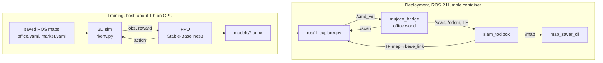
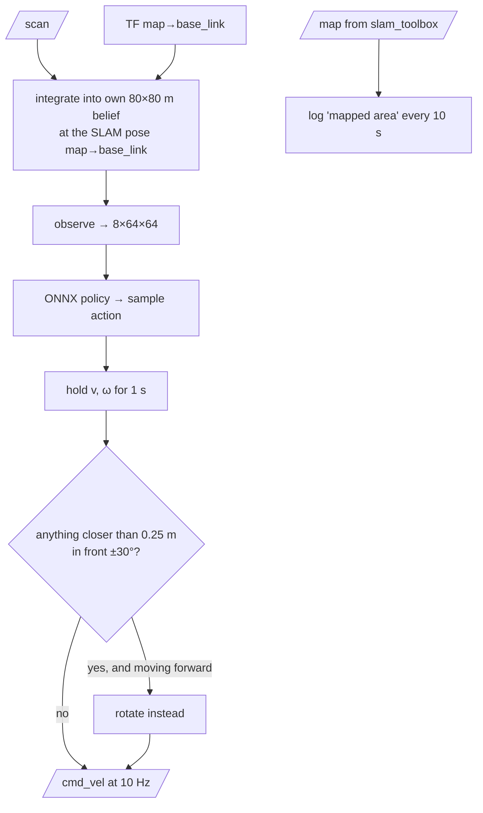

# AMR RL Mapping

A reinforcement-learning explorer for the differential-drive AMR from
[`AMR_Practice_project`](../AMR_Practice_project). A PPO policy decides where the robot drives,
while `slam_toolbox` builds the map. It replaces the hand-written frontier logic in that project's
`lidar_explorer` with a learned policy, and is tested against `lidar_explorer` in the same MuJoCo office.

**Result in one line:** in the MuJoCo office the RL explorer maps **twice as fast as `lidar_explorer`
for the first minute** (121 vs 60 m²) and stays ahead for about 10 minutes, but then levels off at
about 270 m² while `lidar_explorer` keeps going to about 400 m² in 15 minutes. Leaving rooms that are
already mapped is still the weak spot. See [Results](#results).



## Contents

1. [How it works](#how-it-works)
2. [Repository layout](#repository-layout)
3. [Setup](#setup)
4. [Training](#training)
5. [Evaluation in the 2D sim](#evaluation-in-the-2d-sim)
6. [Running on the MuJoCo robot](#running-on-the-mujoco-robot)
7. [Results](#results)
8. [Problems hit along the way](#problems-hit-along-the-way)
9. [Limitations and next steps](#limitations-and-next-steps)

## How it works

### Why train in a 2D sim instead of MuJoCo

PPO needs millions of decisions. The full MuJoCo + ROS + SLAM stack runs in real time at one
decision per second, so 3M steps would take about 35 days. The 2D sim takes about 2 ms per step,
and 12 copies in parallel train 3M steps in about 70 minutes on the CPU. MuJoCo is used only to test
the trained policy end to end.

The sim keeps what matters for exploration from the real robot:

| Real robot (`AMR_Practice_project`) | 2D sim (`rl/env.py`) |
|---|---|
| MuJoCo office and supermarket worlds | ground truth = the maps the robot saved with SLAM (`maps/office.yaml`, `maps/market.yaml`), downsampled to 0.1 m per cell. Unknown cells count as walls. |
| 360-beam lidar, 1°, 0.1–10 m | 180 beams (2°), 10 m, ray-cast on the truth grid |
| diff drive, `lidar_explorer` limits v ≤ 0.2 m/s, ω ≤ 0.8 rad/s | unicycle kinematics with the same limits, 10 sub-steps per action |
| robot radius 0.15 m | collision when the centre enters walls inflated by 0.2 m (radius + 5 cm). The robot stops translating but still rotates. |
| wheel PI loop, caster friction | 10% random actuation noise on v and ω |
| `rl_explorer` lidar guard | the same guard: no forward motion if a return within ±30° is closer than 0.25 m |

Spawn points are random over the largest free area of each map that the robot can reach, with a
random heading. Each episode uses the office (390 m² mappable) or the supermarket (77 m²).

### The MDP

| | |
|---|---|
| **Observation** | `uint8 (8, 64, 64)`: two egocentric crops of the robot's *own* map, centred on the robot and rotated so it faces up. The **local** crop is 0.1 m/px (6.4 m window), the **global** crop 0.8 m/px (51.2 m window, max-pooled). Each crop has 4 channels: free, occupied, visited (trail), frontier (free cells next to unknown). |
| **Actions** | 5 discrete (v, ω) commands, each held for 1 s: forward (0.2, 0), arc left (0.2, 0.6), arc right (0.2, −0.6), rotate left (0, 0.8), rotate right (0, −0.8) |
| **Reward** | newly mapped area in m² (free + occupied cells), −0.02 per step, −0.5 per collision |
| **Episode** | 1000 steps, or ends early at 95% of the reachable free area mapped. **Half of the training episodes start part-explored**: scans from 2–12 random spots within 3–15 m of the spawn are already in the map, so "this area is done, go somewhere else" is a common situation in training. |

The policy never sees ground truth, only what its lidar has mapped.

### Algorithm

PPO from Stable-Baselines3 with the standard `CnnPolicy` (NatureCNN feature extractor, separate
actor and critic heads).

| Hyperparameter | Value |
|---|---|
| parallel envs | 12 (`SubprocVecEnv`) |
| `n_steps` / `batch_size` / `n_epochs` | 256 / 512 / 4 |
| learning rate | 2.5e-4 |
| γ / GAE λ | 0.995 / 0.95 |
| clip range | 0.1 |
| entropy coefficient | 0.01 |
| total steps | 3M, checkpoint every 500k |

The policy is exported to ONNX (raw `uint8` observation in, action logits out) and run with
`onnxruntime`, so the ROS container does not need PyTorch. **Actions are sampled from the softmax of
the logits, as in training.** Always picking the most likely action (argmax) drives the robot into a
wall and keeps it there.

### Model versions

| Model | Observation | Training | Notes |
|---|---|---|---|
| v1 | 6 channels (no frontier) | fresh starts only, 600 steps, γ 0.99; stopped at 2.3M, 2M checkpoint used | got stuck in rooms it had already mapped |
| **v2, 2.5M checkpoint** (`ppo_explore_v2_2500k`) | 8 channels | 50% part-explored starts, 1000 steps, γ 0.995 | **recommended**: most reliable in the office |
| v2 final (3M) | 8 channels | same | worse than 2.5M: performance dropped at the end of training |

`rl_explorer.py` reads the model's input size and works with both 6-channel and 8-channel models.

### One mapping code path for training and deployment

`rl/mapping.py` is numpy-only and is imported by both the env and the ROS node:

- `cast()` simulates the lidar on the truth grid (sim only).
- `integrate()` writes one scan into the belief map: cells before the return become free, the return
  cell becomes occupied, and a beam with no return marks free space out to 10 m. The sim calls it
  with simulated ranges, the ROS node calls it with the real `/scan`.
- `frontier()` marks free cells next to unknown space.
- `observe()` builds the egocentric observation.

Because the node builds its observation with the same functions the policy was trained on, the
policy sees the same kind of map in MuJoCo as in training. See
[Problems hit along the way](#problems-hit-along-the-way) for why the node does not feed SLAM's `/map` to the policy.

### The ROS node (`ros/rl_explorer.py`)



- Decisions at 1 Hz (same as training), `/cmd_vel` published at 10 Hz.
- **Lidar guard**, checked at 10 Hz: if the current action drives forward and any return in front (±30°)
  is closer than `stop_dist` (0.25 m), the robot rotates in place instead.
- Logs `mapped area: X m^2` from SLAM's `/map` every 10 s, using the same metric as `lidar_explorer`
  (known cells × resolution²), so the two explorers can be compared directly.
- Stops after `max_time_s` (default 900 s) with `exploration finished`. Ctrl-C sends a zero `Twist`
  before exiting.

Parameters: `model` (ONNX path), `max_time_s`, `stop_dist`.

## Repository layout

```
AMR_RL_Mapping/
├── README.md
├── docs/                 result plots and maps shown in this README
├── rl/
│   ├── mapping.py        numpy-only core: map loading, lidar cast/integrate, frontier, observation (shared with ROS)
│   ├── env.py            Gymnasium env ExploreEnv; `python env.py` runs a self-check
│   ├── train.py          PPO training + ONNX export; `python train.py model.zip` re-exports only
│   └── evaluate.py       PPO vs frontier vs random on fixed spawns, plots + summary
└── ros/
    ├── rl_explorer.py    ROS 2 node running the ONNX policy
    ├── sim_test.sh       headless end-to-end MuJoCo run (bridge + SLAM + explorer + map save)
    ├── plot_runs.py      mapped area vs time from sim_test.sh run folders
    └── map_probe.py      debug: prints arrival time and known area of every /map message
```

Not in git (see `.gitignore`): `models/` (trained policies and checkpoints) and `runs/` (training
logs, MuJoCo run outputs). **After cloning, train a model first** ([Training](#training)).

The robot, worlds, SLAM config and saved maps come from `../AMR_Practice_project` and are not
copied here. The env reads maps from `~/projects/AMR_Practice_project/src/amr_bot/maps` (override
with the `AMR_MAPS` environment variable).

## Setup

### Host (training and evaluation)

```bash
cd ~/projects/AMR_RL_Mapping
python3 -m venv .venv
.venv/bin/pip install torch --index-url https://download.pytorch.org/whl/cpu
.venv/bin/pip install gymnasium stable-baselines3 onnx onnxruntime matplotlib
cd rl && ../.venv/bin/python env.py        # self-check, prints ms/step and "ok"
```
CPU-only PyTorch is enough: the env, not the network, sets most of the pace, and the CUDA wheels
need several GB of disk.

### Container (MuJoCo + ROS 2)

The container is a copy of the `amr` container from `AMR_Practice_project` (it already has the
GLFW libraries `mujoco_bridge` links against), with this project mounted at `/rl`. With display
access for the MuJoCo viewer and RViz:

```bash
docker commit amr amr_rl:base
xhost +local:docker
docker run -it --name amr_rl --net=host \
  -e DISPLAY=$DISPLAY -v /tmp/.X11-unix:/tmp/.X11-unix \
  --device /dev/dri/card0 --device /dev/dri/renderD128 \
  -v ~/projects/AMR_Practice_project:/ros2_ws \
  -v ~/projects/AMR_RL_Mapping:/rl \
  --entrypoint bash amr_rl:base
pip install onnxruntime          # inside the container, once
```
`amr_bot` must already be built in `/ros2_ws/install` (see the `AMR_Practice_project` README).
Later sessions: `xhost +local:docker && docker start -ai amr_rl`; more terminals with
`docker exec -it amr_rl bash`. For headless runs only, leave out the `DISPLAY`, X11 and `/dev/dri` options.

## Training

```bash
cd ~/projects/AMR_RL_Mapping/rl
mkdir -p ../models ../runs
setsid nohup ../.venv/bin/python -W ignore train.py 3e6 ppo_explore_v2 > ../runs/train_ppo_explore_v2.log 2>&1 &
```
- `setsid nohup` keeps training alive if the terminal or session closes (v1 was killed at 2.3M steps that way).
- Writes `models/ppo_explore_v2.zip` + `.onnx`, and checkpoints every 500k steps in `models/ckpt/`.
- About 650–750 steps/s on a 16-core laptop CPU, so 3M steps take about 70 minutes.
- Progress: `grep -E "total_timesteps|ep_rew_mean" ../runs/train_ppo_explore_v2.log | tail -2`.
- Export a checkpoint to ONNX: `../.venv/bin/python train.py ../models/ckpt/ppo_explore_v2_2499960_steps.zip`.
  **Compare the checkpoints** ([below](#checkpoint-comparison)): the last one is not always the best.

## Evaluation in the 2D sim

```bash
cd ~/projects/AMR_RL_Mapping/rl
../.venv/bin/python evaluate.py ../models/ppo_explore_v2_2500k.onnx 10     # 10 episodes per map
```
Each policy runs from the same spawn points (seeds 1000, 1001, …) for 1000 s:

| Policy | What it does |
|---|---|
| `ppo` | the exported ONNX policy, actions sampled from its output |
| `frontier` | classic baseline: BFS on its own map to the nearest frontier, steers at a point 0.5 m along the route. Plans with a 0.1 m extra margin, falls back to no margin in tight spots, remembers bumped cells, and blacklists a goal after 30 s without new map (as `lidar_explorer` does). |
| `random` | uniform random actions |

Outputs next to the model: `*_eval.txt` (final coverage, coverage at 300 s, episodes reaching 90%
and median time to get there, collisions), `*_coverage.png` (mean coverage vs time), and
`*_office_episode.png` / `*_market_episode.png` (final map and path of one PPO episode).

## Running on the MuJoCo robot

### Manually, with RViz

Five terminals in the container, each first running
`source /opt/ros/humble/setup.bash && source /ros2_ws/install/setup.bash`:
```bash
# 1. robot + office world (viewer window opens)
LIBGL_ALWAYS_SOFTWARE=1 ros2 run amr_bot mujoco_bridge --ros-args -p scene:=/ros2_ws/src/amr_bot/models/world/office_scene.xml
# 2. TF from the URDF
ros2 launch amr_bot rsp.launch.py
# 3. SLAM
ros2 run slam_toolbox async_slam_toolbox_node --ros-args --params-file /ros2_ws/src/amr_bot/config/async_slam_toolbox_cfg.yaml
# 4. RL explorer (start after SLAM is up)
python3 /rl/ros/rl_explorer.py --ros-args -p model:=/rl/models/ppo_explore_v2_2500k.onnx -p max_time_s:=900.0
# 5. RViz
rviz2
```
In RViz, set the fixed frame to `map` and add `Map` on `/map` (durability Transient Local),
`LaserScan` on `/scan` and `RobotModel`. Do not run teleop or `lidar_explorer` at the same time,
because they also publish `/cmd_vel`. To compare, replace terminal 4 with `ros2 run amr_bot lidar_explorer`.
Save the map when done:
```bash
ros2 run nav2_map_server map_saver_cli -f /ros2_ws/src/amr_bot/maps/office_rl
```

### Headless, scripted

```bash
docker exec amr_rl /rl/ros/sim_test.sh rl 900 /rl/models/ppo_explore_v2_2500k.onnx
docker exec amr_rl /rl/ros/sim_test.sh frontier 900           # lidar_explorer
```
It starts `mujoco_bridge` (office, no viewer), `robot_state_publisher` and `slam_toolbox`, then the
explorer. After the given time it saves the SLAM map and stops the nodes it started. Output goes to
`runs/sim_<explorer>_<HHMMSS>/`: `map.pgm`/`map.yaml` and one log per node.
- **It runs in its own ROS domain (`ROS_DOMAIN_ID=42`)** and stops only its own process groups,
  so it can run alongside an interactive simulation in the same container.
- Plot runs: `.venv/bin/python ros/plot_runs.py out.png RL=runs/sim_rl_X frontier=runs/sim_frontier_Y`.

### On a physical robot

The node only needs `/scan` (360° lidar, middle index = straight ahead), TF `map→base_link` (from
slam_toolbox) and a `/cmd_vel` subscriber. It has only been tested in simulation: start with a
short budget (`-p max_time_s:=120.0`), a larger guard (`-p stop_dist:=0.4`), and a hand on the e-stop.

## Results

### 2D sim: v2 (2.5M) vs baselines

10 spawns per map, 1000 s each, lidar guard on for every policy. Full output in [docs/sim_eval.txt](docs/sim_eval.txt).

| Map | Policy | Final coverage | Coverage at 300 s | Reached 90% | Median time to 90% | Collisions / episode |
|---|---|---|---|---|---|---|
| office | **PPO v2** | 0.869 ± 0.23 | 0.631 | 9/10 | **398 s** | 158 |
| office | frontier | **0.951 ± 0.00** | **0.719** | **10/10** | 570 s | 1.5 |
| office | random | 0.397 ± 0.16 | 0.319 | 0/10 | – | 157 |
| supermarket | PPO v2 | 0.821 ± 0.14 | **0.786** | 2/10 | 488 s | 67 |
| supermarket | frontier | **0.868 ± 0.17** | 0.767 | **8/10** | 403 s | 2.2 |
| supermarket | random | 0.662 ± 0.15 | 0.409 | 1/10 | 615 s | 269 |


In 9 of 10 office episodes PPO reaches 90% coverage about 3 minutes sooner than the frontier
baseline; one bad episode pulls its mean down. The frontier baseline is more reliable and almost never
collides. PPO bumps walls often: in the sim this costs only time, while in MuJoCo the guard turns the
robot away before it touches.


### Checkpoint comparison

8 spawns per map, 1000 s, guard on. Mean final coverage ± std, and coverage at 300 s:

| Model | Office final | Office @300 s | Supermarket final | Supermarket @300 s |
|---|---|---|---|---|
| v1 (2M) | 0.741 ± 0.26 | 0.739 | 0.933 ± 0.03 | 0.923 |
| v2 1M | 0.907 ± 0.12 | 0.722 | **0.943 ± 0.02** | 0.883 |
| v2 1.5M | 0.888 ± 0.11 | 0.662 | 0.884 ± 0.09 | 0.791 |
| v2 2M | 0.773 ± 0.21 | 0.549 | 0.915 ± 0.04 | 0.852 |
| **v2 2.5M** | **0.945 ± 0.01** | 0.702 | 0.853 ± 0.06 | 0.810 |
| v2 3M (final) | 0.647 ± 0.28 | 0.567 | 0.879 ± 0.08 | 0.804 |

v2 finishes more of the office than v1 at most checkpoints, but quality jumps around from one
checkpoint to the next. 2.5M is the one that finishes the office reliably, so it is the recommended
model. With 8 episodes the ± values are large; differences of a few percent are noise.

### MuJoCo office, 900 s

SLAM mapped area (known cells, m²) from the explorer logs:

| Explorer | 60 s | 300 s | 600 s | 900 s |
|---|---|---|---|---|
| RL v2 final (3M) | **120.8** | **232.8** | **264.4** | 272.2 |
| `lidar_explorer` | 59.5 | 204.4 | 252.0 | **397.5** |

| RL v2 final (3M) | `lidar_explorer` |
|---|---|
|  |  |

The RL explorer is about twice as fast at first, because it heads for open space without stopping to
plan. After about 10 minutes it has mapped the big rooms and the corridor but stays out of the
remaining side rooms, which it has already seen through their doorways. `lidar_explorer` is slower at
first but works through every frontier and ends up with about 45% more area.

## Problems hit along the way

**1. The ONNX export picked different actions from the trained model 16% of the time.**
SB3's `extract_features()` already divides image observations by 255, and the export wrapper divided
again. Fixed by passing the raw `uint8` tensor. A check comparing ONNX and SB3 greedy actions on 200
env steps now agrees 200/200.

**2. In MuJoCo the policy spun in place forever.**
`map_probe.py` showed slam_toolbox publishing a 3.1 m² sparse blob right after startup and not
growing it while the robot only rotated. In training, the first scan already shows everything within
10 m, so a near-empty map was something the policy had never seen; it rotated, which never updated
the map. Fixed by having the node build its own belief from `/scan` with the same `integrate()` as
training, placed with SLAM's pose. SLAM still produces the saved map and the area metric.

**3. Picking the most likely action got the robot stuck against walls.**
With argmax, v1 chose "forward" 98% of the time in the office and pushed into a wall for the rest
of the episode (34% coverage). Sampling from the policy, as PPO does in training, gave 91%.
Both the evaluator and the node now sample.

**4. v1 got stuck in rooms it had already mapped** (side rooms and the south wing only seen through
doorways). In training, episodes started from an empty map and were 600 steps long, so "everything
around me is done, walk somewhere far" rarely happened, and the policy had to infer frontiers from
coarse pooled pixels. v2 added the frontier channel, part-explored starts, 1000-step episodes and
γ 0.995. It mapped more of the office, but in MuJoCo it still levels off once only side rooms remain.

**5. The last checkpoint was not the best.** v2's average episode reward peaked at about 88 and dropped to
72 by 3M steps, and office coverage dropped from 0.945 (2.5M) to 0.647 (3M). PPO with a constant
learning rate and entropy is not monotonic; evaluate the checkpoints and keep the best one.

**6. The sim and the robot handled walls differently.** The node had a lidar guard; the sim did not,
so sim results punished wall-pushing that cannot happen on the robot. The guard is now in the sim
too (`ExploreEnv(guard=True)`, the default).

**7. The frontier baseline got stuck in three different ways**, each fixed the way a real explorer would:
- Driving into single-cell obstacles the 2° sim lidar misses: remember bumped cells.
- Rubbing along walls because the planned route hugged the inflation edge: plan with a 0.1 m extra
  margin, with a no-margin fallback and a small escape zone around the robot.
- Chasing frontiers through gaps in the map border that it could never reach: blacklist the goal
  after 30 s without new map.

**8. Integration issues:**
- ROS parameter type: `max_time_s:=90` is an integer, but the node declares a double.
- `set -u` broke `setup.bash`.
- Container-created files are owned by root; `sim_test.sh` now gives them back to the host user.
- `sim_test.sh` originally cleaned up with `pkill` by process name, which would also kill an
  interactive simulation in the same container. It now stops only its own process groups and uses its own ROS domain.

## Limitations and next steps

- **Leaving finished areas is still weak.** The best fix is probably a hybrid: let the RL policy drive
  while it is making progress, and hand over to a frontier planner (like `lidar_explorer`) when the
  mapped area stops growing for 30–60 s. Learned alternatives: reward shaping with the BFS distance to the
  nearest frontier, or having the policy choose among frontier goals instead of choosing motor commands.
- **Many collisions in the sim** (60–160 per 1000 s). A larger collision penalty, or ending the
  episode on repeated bumping, would teach the policy to rely less on the guard.
- **Two training maps only.** A policy trained on two buildings may overfit them. Procedurally
  generated floor plans would show whether it generalizes.
- **Training is unstable** from checkpoint to checkpoint. A decaying learning rate or entropy coefficient,
  and evaluating on more spawns before picking a model, would help.
- **Sim-to-sim gap:** exact poses, an ideal lidar and no wheel dynamics in training; the node uses
  SLAM's pose, so SLAM drift shows up as a blurry belief map.
- **No stopping rule learned:** the node stops on a time budget, not when the map is complete.
