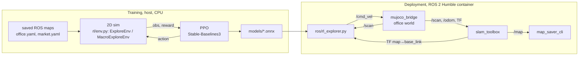
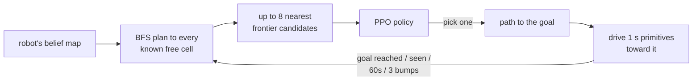
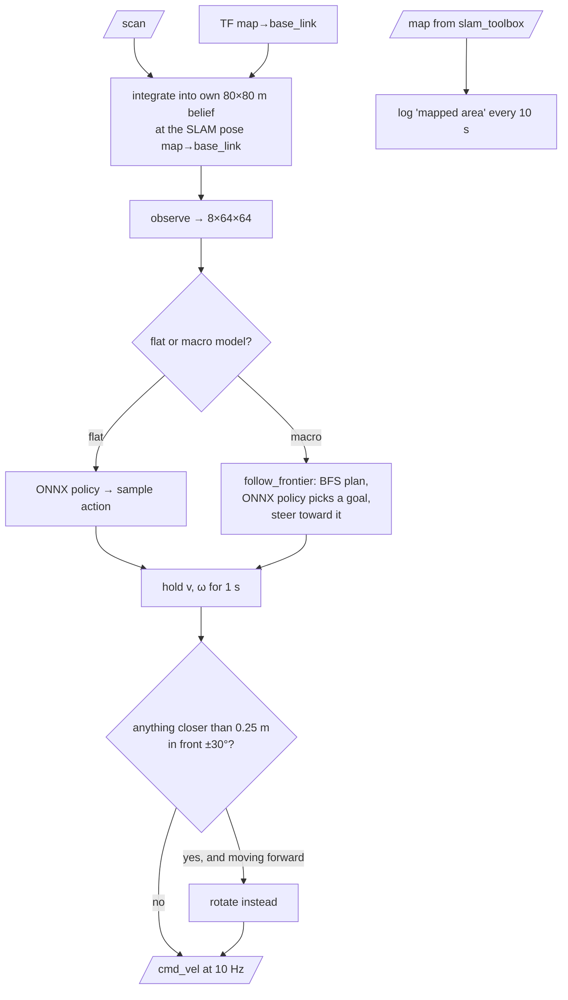
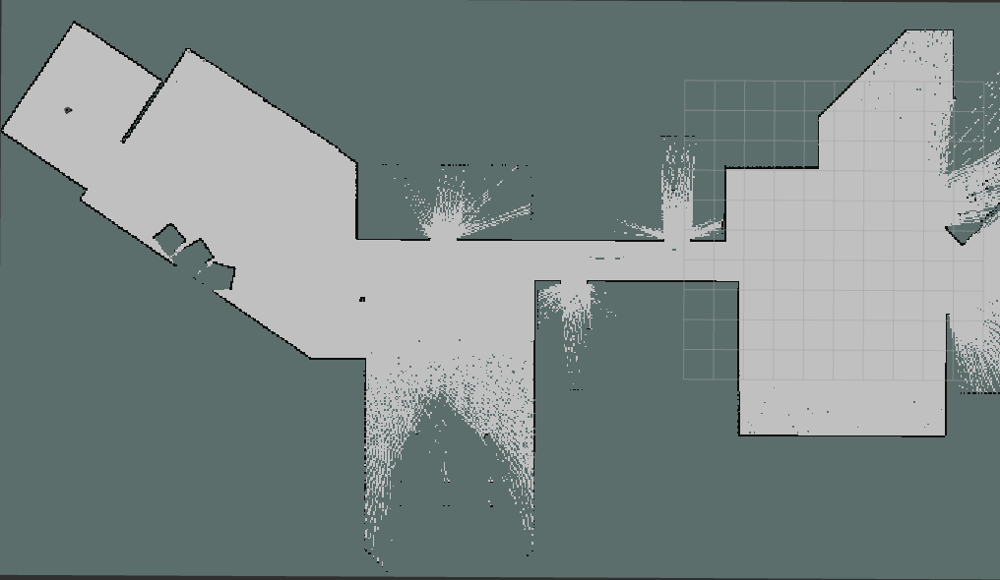
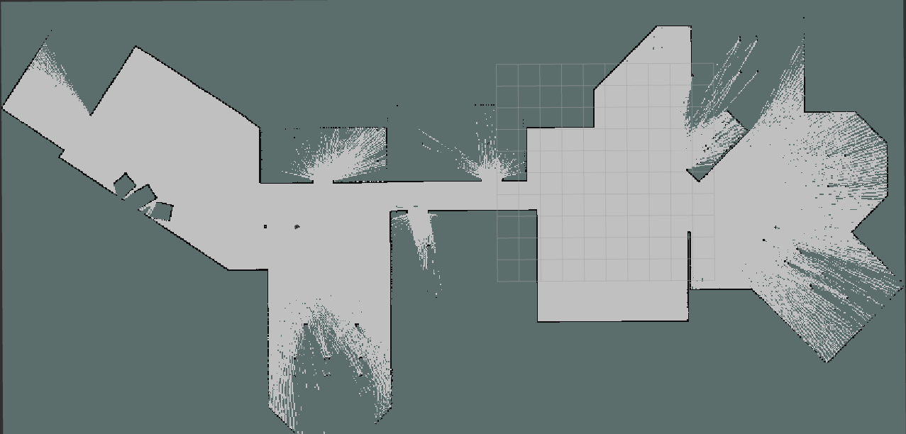
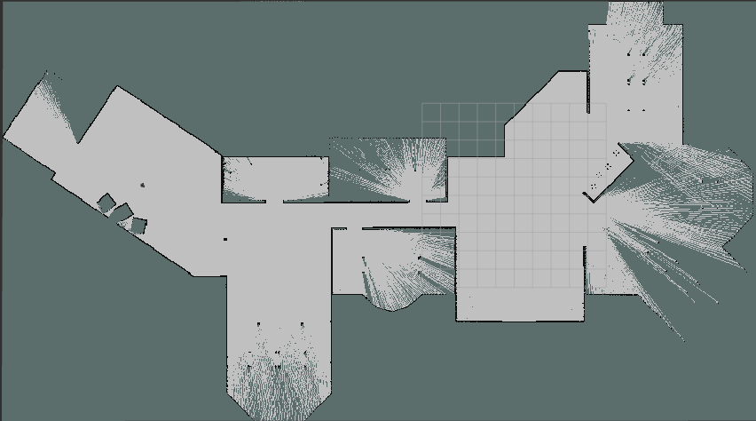
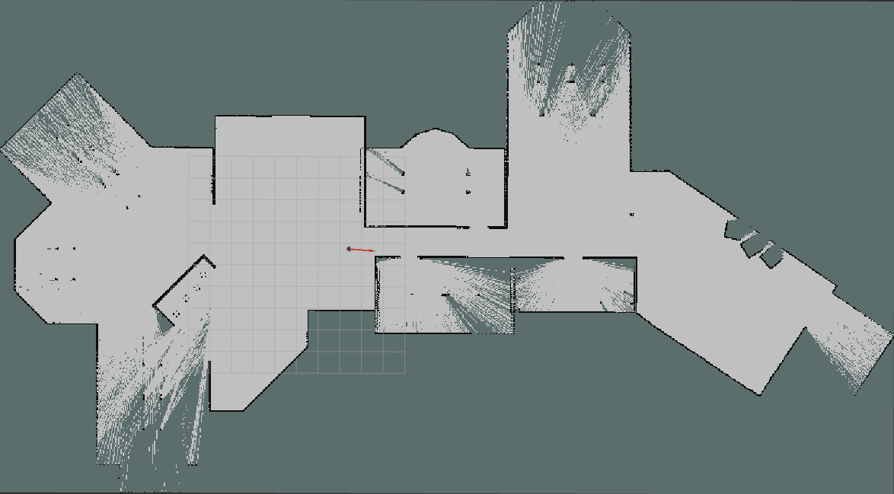

# AMR RL Mapping

A reinforcement-learning explorer for the differential-drive AMR from
[`AMR_Practice_project`](../AMR_Practice_project). A PPO policy decides where the robot drives,
while `slam_toolbox` builds the map. It replaces the hand-written frontier logic in that project's
`lidar_explorer` with a learned policy, and is tested against `lidar_explorer` in the same MuJoCo office.

**Result in one line:** the current model (**v3**) picks *which frontier to explore next* rather than
raw motor commands, which fixes the long-standing "stops before the building is fully mapped" problem
in the clean 2D simulator — every policy tested there, including a random one, now finishes both test
maps. On the real MuJoCo + SLAM stack v3 beats v2 (326–351 vs. 272 m² in 15 minutes) but still
falls short of `lidar_explorer` (398 m²), because of a planner bug that falsely declares exploration
complete with whole rooms unmapped — understood, but not yet fixed. See
[Results](#results) and [Limitations](#limitations-and-next-steps).



**v3's decision loop** (replacing the old "pick a motor command every second" loop): the policy
chooses one of up to 8 nearby unexplored-area candidates; a shared BFS planner (`rl/frontier.py`)
drives there with the same 1 s motion primitives as before, for as long as 60 s, before the policy
is asked again.



## Contents

1. [How it works](#how-it-works)
2. [Repository layout](#repository-layout)
3. [Setup](#setup)
4. [Training](#training)
5. [Evaluation in the 2D sim](#evaluation-in-the-2d-sim)
6. [Running on the MuJoCo robot](#running-on-the-mujoco-robot)
7. [Results](#results)
8. [Problems hit along the way](#problems-hit-along-the-way)
9. [Limitations and next steps](#limitations-and-next-steps)

## How it works

### Why train in a 2D sim instead of MuJoCo

PPO needs millions of decisions. The full MuJoCo + ROS + SLAM stack runs in real time at one
decision per second, so 3M steps would take about 35 days. The 2D sim takes about 2 ms per step,
and 12 copies in parallel train 3M steps in about 70 minutes on the CPU. MuJoCo is used only to test
the trained policy end to end.

The sim keeps what matters for exploration from the real robot:

| Real robot (`AMR_Practice_project`) | 2D sim (`rl/env.py`) |
|---|---|
| MuJoCo office and supermarket worlds | ground truth = the maps the robot saved with SLAM (`maps/office.yaml`, `maps/market.yaml`), downsampled to 0.1 m per cell. Unknown cells count as walls. |
| 360-beam lidar, 1°, 0.1–10 m | 180 beams (2°), 10 m, ray-cast on the truth grid |
| diff drive, `lidar_explorer` limits v ≤ 0.2 m/s, ω ≤ 0.8 rad/s | unicycle kinematics with the same limits, 10 sub-steps per action |
| robot radius 0.15 m | collision when the centre enters walls inflated by 0.2 m (radius + 5 cm). The robot stops translating but still rotates. |
| wheel PI loop, caster friction | 10% random actuation noise on v and ω |
| `rl_explorer` lidar guard | the same guard: no forward motion if a return within ±30° is closer than 0.25 m |

Spawn points are random over the largest free area of each map that the robot can reach, with a
random heading. Each episode uses the office (390 m² mappable) or the supermarket (77 m²).

### The MDP

There are now two environments in `rl/env.py`: the original flat `ExploreEnv` (v1/v2) and the
hierarchical `MacroExploreEnv` (v3, the current recommended one). They share the same map, lidar,
reward and movement code — only the action space and what counts as "one step" differ.

**v1/v2 — `ExploreEnv`, flat action space:**

| | |
|---|---|
| **Observation** | `uint8 (8, 64, 64)`: two egocentric crops of the robot's *own* map, centred on the robot and rotated so it faces up. The **local** crop is 0.1 m/px (6.4 m window), the **global** crop 0.8 m/px (51.2 m window, max-pooled). Each crop has 4 channels: free, occupied, visited (trail), frontier (free cells next to unknown). |
| **Actions** | 5 discrete (v, ω) commands, each held for 1 s: forward (0.2, 0), arc left (0.2, 0.6), arc right (0.2, −0.6), rotate left (0, 0.8), rotate right (0, −0.8) |
| **Reward** | newly mapped area in m² (free + occupied cells), −0.02 per step, −0.5 per collision |
| **Episode** | 1000 steps, or ends early at 95% of the reachable free area mapped. **Half of the training episodes start part-explored**: scans from 2–12 random spots within 3–15 m of the spawn are already in the map, so "this area is done, go somewhere else" is a common situation in training. |

**v3 — `MacroExploreEnv`, hierarchical action space:**

| | |
|---|---|
| **Observation** | a `Dict`: the same 8-channel map crop above, **plus** `cands`, up to 8 nearby unexplored-area candidates (one per ~1 m×1 m bin of frontier cells, nearest first), each with 6 features — path distance, direction (forward/left offset), size, and nearby unknown area. |
| **Actions** | pick one of the 8 candidates. A shared BFS planner (`rl/frontier.py`) then drives there automatically, using the same 1 s motion primitives as v1/v2. |
| **Reward** | the sum of the per-second rewards (same formula as above) accumulated while driving to the chosen candidate |
| **"Step"** | lasts until the goal is reached, becomes no-longer-unexplored, 60 s pass, or the robot bumps 3 times — anywhere from about 5 to 60 s of robot time, instead of 1 s |

In both cases the policy never sees ground truth, only what its own lidar has mapped.

### Algorithm

PPO from Stable-Baselines3. v1/v2 use the standard `CnnPolicy` (NatureCNN feature extractor); v3 uses
`MultiInputPolicy` (NatureCNN on the map crop + an MLP on the candidate features, concatenated) to
match its `Dict` observation.

| Hyperparameter | v1/v2 (flat) | v3 (macro) |
|---|---|---|
| parallel envs | 12 (`SubprocVecEnv`) | same |
| `n_steps` / `batch_size` / `n_epochs` | 256 / 512 / 4 | 128 / 256 / 4 |
| learning rate | 2.5e-4 | same |
| γ / GAE λ | 0.995 / 0.95 | 0.99 / 0.95 |
| clip range | 0.1 | same |
| entropy coefficient | 0.01 | same |
| total steps | 3M, checkpoint every 500k | ~100k, checkpoint every 50k (one "step" now covers 5–60 s, so far fewer are needed) |

`python train.py STEPS NAME macro` trains the hierarchical v3 env; without the trailing `macro` it
trains the original flat env. Either way the policy is exported to ONNX (`onnxruntime` in the ROS
container, no PyTorch needed), and the node/evaluator auto-detect which kind of model they're given
by how many inputs the ONNX file has. **Actions, and v3's frontier choice, are sampled from the
policy's output distribution, as in training.** Always picking the single most likely option (argmax)
drove the flat v1/v2 policy into a wall and kept it there.

### Model versions

| Model | Architecture | Training | Notes |
|---|---|---|---|
| v1 | flat, 6 channels (no frontier) | fresh starts only, 600 steps, γ 0.99; stopped at 2.3M, 2M checkpoint used | got stuck in rooms it had already mapped |
| v2, 2.5M checkpoint (`ppo_explore_v2_2500k`) | flat, 8 channels | 50% part-explored starts, 1000 steps, γ 0.995 | most reliable of the flat models in the office; still only finishes 2/10 market episodes |
| v2 final (3M) | flat, 8 channels | same | worse than 2.5M: performance dropped at the end of training |
| **v3, 100k checkpoint** (`ppo_macro_v3_100k`) | **hierarchical**: picks a frontier candidate, BFS planner drives | γ 0.99, ~100k macro steps | **recommended in the 2D sim** — only model that reliably finishes *both* test maps; **not yet recommended in MuJoCo** — see [Limitations](#limitations-and-next-steps) |

`rl_explorer.py` and `evaluate.py` both read the model's ONNX input signature and auto-select the
right environment/behavior: 6-channel and 8-channel flat models, and the `{map, cands}` macro model,
all work with the same node and evaluation script.

### One mapping code path for training and deployment

`rl/mapping.py` is numpy-only and is imported by both the env and the ROS node:

- `cast()` simulates the lidar on the truth grid (sim only).
- `integrate()` writes one scan into the belief map: cells before the return become free, the return
  cell becomes occupied, and a beam with no return marks free space out to 10 m. The sim calls it
  with simulated ranges, the ROS node calls it with the real `/scan`.
- `frontier()` marks free cells next to unknown space.
- `observe()` builds the egocentric observation.

Because the node builds its observation with the same functions the policy was trained on, the
policy sees the same kind of map in MuJoCo as in training. See
[Problems hit along the way](#problems-hit-along-the-way) for why the node does not feed SLAM's `/map` to the policy.

v3 adds `rl/frontier.py`, also numpy-only, shared the same way: it does the BFS planning, picks the
frontier candidates offered to the policy, and drives toward whichever one is chosen. It's used by
training (`MacroExploreEnv`), the `greedy`/`random` baselines in `evaluate.py`, and the ROS node —
so the learned policy, the classic-frontier baseline, and the real robot all plan and drive with
*exactly* the same code.

### The ROS node (`ros/rl_explorer.py`)



- Decisions at 1 Hz (same as training), `/cmd_vel` published at 10 Hz.
- **Auto-detects flat vs. macro models** from the ONNX file's number of inputs, so the same node runs
  v1, v2, or v3 unchanged.
- **Lidar guard**, checked at 10 Hz: if the current action drives forward and any return in front (±30°)
  is closer than `stop_dist` (0.25 m), the robot rotates in place instead.
- Logs `mapped area: X m^2` from SLAM's `/map` every 10 s, using the same metric as `lidar_explorer`
  (known cells × resolution²), so the two explorers can be compared directly.
- Stops after `max_time_s` (default 900 s) with `exploration finished`. Ctrl-C sends a zero `Twist`
  before exiting. **With a macro model**, it can also stop earlier by declaring
  `exploration complete: no reachable frontier left` — currently sometimes wrong, see
  [Limitations](#limitations-and-next-steps).

Parameters: `model` (ONNX path), `max_time_s`, `stop_dist`.

## Repository layout

```
AMR_RL_Mapping/
├── README.md
├── PROJECT_DETAILS.md    full technical reference (every module/function, known issues, refactor guide)
├── docs/                 result plots and maps shown in this README
├── media/                MuJoCo/RViz map screenshots per model version (v1, v2_3M, v3, v3_100k)
├── rl/
│   ├── mapping.py        numpy-only core: map loading, lidar cast/integrate, frontier, observation (shared with ROS)
│   ├── frontier.py       numpy-only BFS planner, frontier candidates, path follower (shared with ROS)
│   ├── env.py            Gymnasium envs ExploreEnv (flat) and MacroExploreEnv (v3); `python env.py` runs a self-check
│   ├── train.py          PPO training (flat or macro) + ONNX export; `python train.py model.zip` re-exports only
│   └── evaluate.py       PPO vs greedy frontier vs random on fixed spawns, plots + summary
└── ros/
    ├── rl_explorer.py    ROS 2 node running the ONNX policy
    ├── sim_test.sh       headless end-to-end MuJoCo run (bridge + SLAM + explorer + map save)
    ├── plot_runs.py      mapped area vs time from sim_test.sh run folders
    └── map_probe.py      debug: prints arrival time and known area of every /map message
```

Not in git (see `.gitignore`): `models/` (trained policies and checkpoints) and `runs/` (training
logs, MuJoCo run outputs). **After cloning, train a model first** ([Training](#training)).

The robot, worlds, SLAM config and saved maps come from `../AMR_Practice_project` and are not
copied here. The env reads maps from `~/projects/AMR_Practice_project/src/amr_bot/maps` (override
with the `AMR_MAPS` environment variable).

## Setup

### Host (training and evaluation)

```bash
cd ~/projects/AMR_RL_Mapping
python3 -m venv .venv
.venv/bin/pip install torch --index-url https://download.pytorch.org/whl/cpu
.venv/bin/pip install gymnasium stable-baselines3 onnx onnxruntime matplotlib
cd rl && ../.venv/bin/python env.py        # self-check, prints ms/step and "ok"
```
CPU-only PyTorch is enough: the env, not the network, sets most of the pace, and the CUDA wheels
need several GB of disk.

### Container (MuJoCo + ROS 2)

The container is a copy of the `amr` container from `AMR_Practice_project` (it already has the
GLFW libraries `mujoco_bridge` links against), with this project mounted at `/rl`. With display
access for the MuJoCo viewer and RViz:

```bash
docker commit amr amr_rl:base
xhost +local:docker
docker run -it --name amr_rl --net=host \
  -e DISPLAY=$DISPLAY -v /tmp/.X11-unix:/tmp/.X11-unix \
  --device /dev/dri/card0 --device /dev/dri/renderD128 \
  -v ~/projects/AMR_Practice_project:/ros2_ws \
  -v ~/projects/AMR_RL_Mapping:/rl \
  --entrypoint bash amr_rl:base
pip install onnxruntime          # inside the container, once
```
`amr_bot` must already be built in `/ros2_ws/install` (see the `AMR_Practice_project` README).
Later sessions: `xhost +local:docker && docker start -ai amr_rl`; more terminals with
`docker exec -it amr_rl bash`. For headless runs only, leave out the `DISPLAY`, X11 and `/dev/dri` options.

## Training

```bash
cd ~/projects/AMR_RL_Mapping/rl
mkdir -p ../models ../runs
# v3, hierarchical (recommended): trailing "macro" selects MacroExploreEnv + MultiInputPolicy
setsid nohup ../.venv/bin/python -W ignore train.py 3e6 ppo_macro_v3 macro > ../runs/train_ppo_macro_v3.log 2>&1 &
# v2-style flat policy
setsid nohup ../.venv/bin/python -W ignore train.py 3e6 ppo_explore_v2 > ../runs/train_ppo_explore_v2.log 2>&1 &
```
- `setsid nohup` keeps training alive if the terminal or session closes (v1 was killed at 2.3M steps that way).
- Writes `models/NAME.zip` + `.onnx`; checkpoints go to `models/ckpt/` (every 50k steps for macro, 500k for flat).
- Flat: about 650–750 steps/s on a 16-core laptop CPU (3M steps ≈ 70 min). Macro steps are each
  5–60 s of simulated driving, so they're slower, but far fewer are needed — v3's best checkpoint is at ~100k.
- Progress: `grep -E "total_timesteps|ep_rew_mean" ../runs/train_ppo_macro_v3.log | tail -2`.
- Export a checkpoint to ONNX: `../.venv/bin/python train.py ../models/ckpt/ppo_macro_v3_99984_steps.zip`.
  **Compare the checkpoints** ([below](#checkpoint-comparison)): the last one is not always the best.

## Evaluation in the 2D sim

```bash
cd ~/projects/AMR_RL_Mapping/rl
../.venv/bin/python evaluate.py ../models/ppo_macro_v3_100k.onnx 10      # 10 episodes per map; flat models work too
```
Each policy runs from the same spawn points (seeds 1000, 1001, …) for 1000 s:

| Policy | What it does |
|---|---|
| `ppo` | the exported ONNX policy, sampled from its output; runs on `MacroExploreEnv` for a v3 model, `ExploreEnv` for a flat one |
| `greedy` | classic frontier exploration: always the nearest candidate, via the same `frontier.py` planner and executor the v3 policy uses. Plans with clearance margin and a fallback for tight doors, remembers bumped cells, and blacklists goals that make no progress. |
| `random` | a random frontier candidate each decision, same planner |

Outputs next to the model: `*_eval.txt` (final coverage, coverage at 300 s, episodes reaching 90%
and median time to get there, collisions), `*_coverage.png` (mean coverage vs time), and
`*_office_episode.png` / `*_market_episode.png` (final map and path of one PPO episode).

## Running on the MuJoCo robot

### Manually, with RViz

Five terminals in the container, each first running
`source /opt/ros/humble/setup.bash && source /ros2_ws/install/setup.bash`:
```bash
# 1. robot + office world (viewer window opens)
LIBGL_ALWAYS_SOFTWARE=1 ros2 run amr_bot mujoco_bridge --ros-args -p scene:=/ros2_ws/src/amr_bot/models/world/office_scene.xml
# 2. TF from the URDF
ros2 launch amr_bot rsp.launch.py
# 3. SLAM
ros2 run slam_toolbox async_slam_toolbox_node --ros-args --params-file /ros2_ws/src/amr_bot/config/async_slam_toolbox_cfg.yaml
# 4. RL explorer (start after SLAM is up)
python3 /rl/ros/rl_explorer.py --ros-args -p model:=/rl/models/ppo_macro_v3_100k.onnx -p max_time_s:=900.0
#    (or model:=/rl/models/ppo_explore_v2_2500k.onnx for the flat v2 policy)
# 5. RViz
rviz2
```
In RViz, set the fixed frame to `map` and add `Map` on `/map` (durability Transient Local),
`LaserScan` on `/scan` and `RobotModel`. Do not run teleop or `lidar_explorer` at the same time,
because they also publish `/cmd_vel`. To compare, replace terminal 4 with `ros2 run amr_bot lidar_explorer`.
Save the map when done:
```bash
ros2 run nav2_map_server map_saver_cli -f /ros2_ws/src/amr_bot/maps/office_rl
```

### Headless, scripted

```bash
docker exec amr_rl /rl/ros/sim_test.sh rl 900 /rl/models/ppo_macro_v3_100k.onnx
docker exec amr_rl /rl/ros/sim_test.sh frontier 900           # lidar_explorer
```
It starts `mujoco_bridge` (office, no viewer), `robot_state_publisher` and `slam_toolbox`, then the
explorer. After the given time it saves the SLAM map and stops the nodes it started. Output goes to
`runs/sim_<explorer>_<HHMMSS>/`: `map.pgm`/`map.yaml` and one log per node.
- **It runs in its own ROS domain (`ROS_DOMAIN_ID=42`)** and stops only its own process groups,
  so it can run alongside an interactive simulation in the same container.
- Plot runs: `.venv/bin/python ros/plot_runs.py out.png RL=runs/sim_rl_X frontier=runs/sim_frontier_Y`.

### On a physical robot

The node only needs `/scan` (360° lidar, middle index = straight ahead), TF `map→base_link` (from
slam_toolbox) and a `/cmd_vel` subscriber. It has only been tested in simulation: start with a
short budget (`-p max_time_s:=120.0`), a larger guard (`-p stop_dist:=0.4`), and a hand on the e-stop.

## Results

### 2D sim: v3 (hierarchical, 100k) vs baselines

10 spawns per map, 1000 s each, guard on. Full output in [docs/sim_v3_eval.txt](docs/sim_v3_eval.txt).

| Map | Policy | Final coverage | Coverage at 300 s | Reached 90% | Median time to 90% | Collisions / episode |
|---|---|---|---|---|---|---|
| office | **PPO v3** | 0.951 ± 0.00 | **0.720** | **10/10** | **408 s** | **4.6** |
| office | greedy frontier | 0.952 ± 0.00 | 0.667 | 10/10 | 431 s | 10.0 |
| office | random frontier | 0.951 ± 0.00 | 0.679 | 10/10 | 410 s | 7.0 |
| supermarket | PPO v3 | 0.961 ± 0.01 | 0.902 | **10/10** | 242 s | 2.0 |
| supermarket | greedy frontier | 0.959 ± 0.01 | **0.959** | 10/10 | **84 s** | 4.2 |
| supermarket | random frontier | 0.959 ± 0.01 | 0.923 | 10/10 | 209 s | 2.4 |

**Every policy finishes all 20 episodes** — something no flat model (v1/v2) ever did (compare the v2
table below: 2/10 on the supermarket). The *architecture* is what fixes it: even random frontier
choice finishes. The *learned* ranking is a mixed bag: slightly faster than greedy in the office,
but about 3× slower in the small supermarket, where it picks the nearest candidate only 12% of the
time — a habit learned on the bigger office map that doesn't transfer. Collisions dropped from
60–160 per episode (v2) to 2–5, since the planner does the driving.


### 2D sim: v2 (2.5M, flat) vs baselines

10 spawns per map, 1000 s each, lidar guard on for every policy. Full output in [docs/sim_eval.txt](docs/sim_eval.txt).
(Here `frontier` is the older hand-written baseline that `greedy` has since replaced; same idea.)

| Map | Policy | Final coverage | Coverage at 300 s | Reached 90% | Median time to 90% | Collisions / episode |
|---|---|---|---|---|---|---|
| office | **PPO v2** | 0.869 ± 0.23 | 0.631 | 9/10 | **398 s** | 158 |
| office | frontier | **0.951 ± 0.00** | **0.719** | **10/10** | 570 s | 1.5 |
| office | random | 0.397 ± 0.16 | 0.319 | 0/10 | – | 157 |
| supermarket | PPO v2 | 0.821 ± 0.14 | **0.786** | 2/10 | 488 s | 67 |
| supermarket | frontier | **0.868 ± 0.17** | 0.767 | **8/10** | 403 s | 2.2 |
| supermarket | random | 0.662 ± 0.15 | 0.409 | 1/10 | 615 s | 269 |


In 9 of 10 office episodes PPO reaches 90% coverage about 3 minutes sooner than the frontier
baseline; one bad episode pulls its mean down. The frontier baseline is more reliable and almost never
collides. PPO bumps walls often: in the sim this costs only time, while in MuJoCo the guard turns the
robot away before it touches.


### Checkpoint comparison

8 spawns per map, 1000 s, guard on. Mean final coverage ± std, and coverage at 300 s:

| Model | Office final | Office @300 s | Supermarket final | Supermarket @300 s |
|---|---|---|---|---|
| v1 (2M) | 0.741 ± 0.26 | 0.739 | 0.933 ± 0.03 | 0.923 |
| v2 1M | 0.907 ± 0.12 | 0.722 | **0.943 ± 0.02** | 0.883 |
| v2 1.5M | 0.888 ± 0.11 | 0.662 | 0.884 ± 0.09 | 0.791 |
| v2 2M | 0.773 ± 0.21 | 0.549 | 0.915 ± 0.04 | 0.852 |
| **v2 2.5M** | **0.945 ± 0.01** | 0.702 | 0.853 ± 0.06 | 0.810 |
| v2 3M (final) | 0.647 ± 0.28 | 0.567 | 0.879 ± 0.08 | 0.804 |

v2 finishes more of the office than v1 at most checkpoints, but quality jumps around from one
checkpoint to the next. 2.5M is the one that finishes the office reliably, so it is the recommended
model. With 8 episodes the ± values are large; differences of a few percent are noise.

### MuJoCo office, 900 s

SLAM mapped area (known cells, m²) from the explorer logs:

| Explorer | 60 s | 300 s | 600 s | 900 s |
|---|---|---|---|---|
| RL v2 final (3M) | **120.8** | **227.0** | **264.3** | 272.2 |
| RL v2 2.5M (run cut off at 423 s) | 49.6 | 209.7 | – | – |
| RL v3 100k, run A | – | – | – | 326.0 (stopped growing at ~436 s) |
| RL v3 100k, run B | – | – | – | 350.9 (stopped growing at ~908 s) |
| `lidar_explorer` | 59.5 | 174.2 | 239.5 | **397.5** |

| v1 | v2 (3M) |
|---|---|
|  |  |

| v3 100k, run A (326 m²) | v3 100k, run B (350.9 m²) |
|---|---|
|  |  |

| `lidar_explorer` (397.5 m²) |
|---|
|  |

The flat RL explorer (v2) is about twice as fast at first, because it heads for open space without
stopping to plan. After about 10 minutes it has mapped the big rooms and the corridor but stays out of
the remaining side rooms, which it has already seen through their doorways. `lidar_explorer` is slower
at first but works through every frontier and ends up with about 45% more area.

v3 gets further than v2 (326–351 vs. 272 m²) but still short of `lidar_explorer`, and both v3 runs
**stop making progress completely** before the time budget ends: run A logged
`exploration complete: no reachable frontier left` at ~436 s with a whole wing unmapped, and run B's
saved map shows a room boxed in by fully-mapped corridors that it never entered. The 2D sim never
shows this — the cause is a planner bug that only appears with real SLAM pose noise (see
[Problems](#problems-hit-along-the-way), item 9).

## Problems hit along the way

**1. The ONNX export picked different actions from the trained model 16% of the time.**
SB3's `extract_features()` already divides image observations by 255, and the export wrapper divided
again. Fixed by passing the raw `uint8` tensor. A check comparing ONNX and SB3 greedy actions on 200
env steps now agrees 200/200.

**2. In MuJoCo the policy spun in place forever.**
`map_probe.py` showed slam_toolbox publishing a 3.1 m² sparse blob right after startup and not
growing it while the robot only rotated. In training, the first scan already shows everything within
10 m, so a near-empty map was something the policy had never seen; it rotated, which never updated
the map. Fixed by having the node build its own belief from `/scan` with the same `integrate()` as
training, placed with SLAM's pose. SLAM still produces the saved map and the area metric.

**3. Picking the most likely action got the robot stuck against walls.**
With argmax, v1 chose "forward" 98% of the time in the office and pushed into a wall for the rest
of the episode (34% coverage). Sampling from the policy, as PPO does in training, gave 91%.
Both the evaluator and the node now sample.

**4. v1 got stuck in rooms it had already mapped** (side rooms and the south wing only seen through
doorways). In training, episodes started from an empty map and were 600 steps long, so "everything
around me is done, walk somewhere far" rarely happened, and the policy had to infer frontiers from
coarse pooled pixels. v2 added the frontier channel, part-explored starts, 1000-step episodes and
γ 0.995. It mapped more of the office, but in MuJoCo it still levels off once only side rooms remain.

**5. The last checkpoint was not the best.** v2's average episode reward peaked at about 88 and dropped to
72 by 3M steps, and office coverage dropped from 0.945 (2.5M) to 0.647 (3M). PPO with a constant
learning rate and entropy is not monotonic; evaluate the checkpoints and keep the best one.

**6. The sim and the robot handled walls differently.** The node had a lidar guard; the sim did not,
so sim results punished wall-pushing that cannot happen on the robot. The guard is now in the sim
too (`ExploreEnv(guard=True)`, the default).

**7. The frontier baseline got stuck in three different ways**, each fixed the way a real explorer would:
- Driving into single-cell obstacles the 2° sim lidar misses: remember bumped cells.
- Rubbing along walls because the planned route hugged the inflation edge: plan with a 0.1 m extra
  margin, with a no-margin fallback and a small escape zone around the robot.
- Chasing frontiers through gaps in the map border that it could never reach: blacklist the goal
  after 30 s without new map.

**8. Integration issues:**
- ROS parameter type: `max_time_s:=90` is an integer, but the node declares a double.
- `set -u` broke `setup.bash`.
- Container-created files are owned by root; `sim_test.sh` now gives them back to the host user.
- `sim_test.sh` originally cleaned up with `pkill` by process name, which would also kill an
  interactive simulation in the same container. It now stops only its own process groups and uses its own ROS domain.

**9. v3 declares "exploration complete" with rooms still unmapped (open, not fixed yet).**
When the robot bumps into something, the planner remembers that cell and treats it as a wall for the
rest of the run. That memory is only cleared if *every* frontier in the building becomes unreachable.
In the 2D sim a bump always means a real obstacle, so this is harmless. With real SLAM, pose drift can
register a bump against a doorway that is actually open; if that doorway is the only way into a room
or wing, the robot finishes the other frontiers, decides nothing reachable is left, and stops. The
planned fix is to let the bump memory expire after 60–120 s. It only touches the planner
(`rl/frontier.py`, `rl/env.py`, `ros/rl_explorer.py`), not the trained weights, so no retraining should be needed.

## Limitations and next steps

- **Fix the permanent bump memory (problem 9)** and re-run v3 in MuJoCo. This is the main reason v3
  currently loses to `lidar_explorer` on the real stack.
- **The learned frontier ranking isn't clearly better than "nearest first"** — slightly faster in the
  office, 3× slower in the supermarket. Options: train with more weight on the small map, more varied
  maps, or ship the greedy planner and keep the learned ranking experimental until it wins on both.
- **Leaving finished areas** — the weak spot of v1/v2 — is solved in the 2D sim by v3's hierarchical
  design (policy picks a frontier, planner drives), so the earlier ideas (hybrid hand-over, reward shaping) weren't needed.
- **Collisions** dropped from 60–160 per 1000 s (v2) to 2–5 (v3), since the planner does the driving.
- **MuJoCo evaluation is thin:** one spawn point, 1–2 runs per model. The two v3 runs differ by
  25 m², so more runs are needed before comparing models closely.
- **Two training maps only.** A policy trained on two buildings may overfit them. Procedurally
  generated floor plans would show whether it generalizes.
- **Training is unstable** from checkpoint to checkpoint. A decaying learning rate or entropy coefficient,
  and evaluating on more spawns before picking a model, would help.
- **Sim-to-sim gap:** exact poses, an ideal lidar and no wheel dynamics in training; the node uses
  SLAM's pose, so SLAM drift shows up as a blurry belief map.
- **Stopping rule:** flat models stop only on the time budget; v3 also stops when no reachable frontier
  is left, which is the right idea but currently fires too early because of problem 9.
