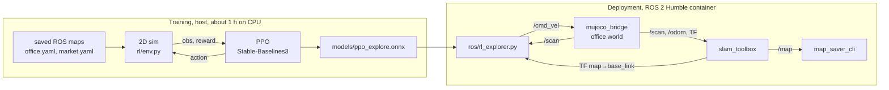
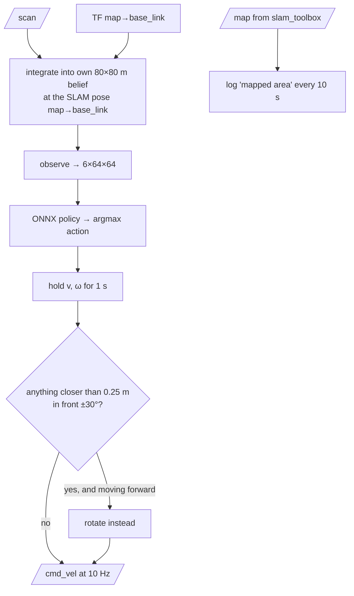

# AMR RL Mapping

A reinforcement-learning explorer for the differential-drive AMR from
[`AMR_Practice_project`](../AMR_Practice_project). A PPO policy decides where the robot drives,
while `slam_toolbox` builds the map. It replaces the hand-written frontier logic in that project's
`lidar_explorer` with a learned policy, and is tested against `lidar_explorer` in the same MuJoCo office.



## Contents

1. [Project status](#project-status)
2. [How it works](#how-it-works)
3. [Repository layout](#repository-layout)
4. [Setup](#setup)
5. [Training](#training)
6. [Evaluation in the 2D sim](#evaluation-in-the-2d-sim)
7. [Running on the MuJoCo robot](#running-on-the-mujoco-robot)
8. [Results](#results)
9. [Problems hit along the way](#problems-hit-along-the-way)
10. [Limitations and next steps](#limitations-and-next-steps)

## Project status

| Phase | Status |
|---|---|
| Plan ([`PLAN.md`](PLAN.md)), 2D sim and Gymnasium env | done, self-check passes |
| Baselines: frontier explorer, random | done |
| PPO training, 3M steps | in progress |
| ROS 2 node `rl_explorer.py` and headless MuJoCo test script | done, smoke-tested with the 500k-step checkpoint |
| Final evaluation (sim and MuJoCo) | pending, waiting for training |

## How it works

### Why train in a 2D sim instead of MuJoCo

PPO needs millions of decisions. The full MuJoCo + ROS + SLAM stack runs in real time at one
decision per second, so 3M steps would take about 35 days. The 2D sim takes about 1.7 ms per step,
and 12 copies in parallel train 3M steps in about an hour on the CPU. MuJoCo is used only to test
the trained policy end to end.

The sim keeps what matters for exploration from the real robot:

| Real robot (`AMR_Practice_project`) | 2D sim (`rl/env.py`) |
|---|---|
| MuJoCo office and supermarket worlds | ground truth = the maps the robot saved with SLAM (`maps/office.yaml`, `maps/market.yaml`), downsampled to 0.1 m per cell. Unknown cells count as walls. |
| 360-beam lidar, 1°, 0.1–10 m | 180 beams (2°), 10 m, ray-cast on the truth grid |
| diff drive, `lidar_explorer` limits v ≤ 0.2 m/s, ω ≤ 0.8 rad/s | unicycle kinematics with the same limits, 10 sub-steps per action |
| robot radius 0.15 m | collision when the centre enters walls inflated by 0.2 m (radius + 5 cm). The robot stops translating but still rotates. |
| wheel PI loop, caster friction | 10% random actuation noise on v and ω |

Spawn points are random over the largest free area of each map that the robot can reach, with a
random heading. Each episode uses the office (390 m² mappable) or the supermarket (77 m²).

### The MDP

| | |
|---|---|
| **Observation** | `uint8 (6, 64, 64)`: two egocentric crops of the robot's *own* map, centred on the robot and rotated so it faces up. The **local** crop is 0.1 m/px (6.4 m window), the **global** crop 0.8 m/px (51.2 m window, max-pooled). Each crop has 3 channels: free, occupied, visited (trail). |
| **Actions** | 5 discrete (v, ω) commands, each held for 1 s: forward (0.2, 0), arc left (0.2, 0.6), arc right (0.2, −0.6), rotate left (0, 0.8), rotate right (0, −0.8) |
| **Reward** | newly mapped area in m² (free + occupied cells), −0.02 per step, −0.5 per collision |
| **Episode end** | 95% of the reachable free area mapped, or 600 steps (1000 in evaluation) |

The policy never sees ground truth, only what its lidar has mapped. The occupied and free channels
show where the walls are and where unexplored space starts; the global crop shows which part of the
building is still unknown; the trail tells it where it has already been, so it can avoid loops.

### Algorithm

PPO from Stable-Baselines3 with the standard `CnnPolicy` (NatureCNN feature extractor, separate
actor and critic heads).

| Hyperparameter | Value |
|---|---|
| parallel envs | 12 (`SubprocVecEnv`) |
| `n_steps` / `batch_size` / `n_epochs` | 256 / 512 / 4 |
| learning rate | 2.5e-4 |
| γ / GAE λ | 0.99 / 0.95 |
| clip range | 0.1 |
| entropy coefficient | 0.01 |
| total steps | 3M |

After training, the policy is exported to ONNX (raw `uint8` observation in, action logits out).
The ROS node runs it with `onnxruntime`, so the container does not need PyTorch.

### One mapping code path for training and deployment

`rl/mapping.py` is numpy-only and is imported by both the env and the ROS node:

- `cast()` simulates the lidar on the truth grid (sim only).
- `integrate()` writes one scan into the belief map: cells before the return become free, the return
  cell becomes occupied, and a beam with no return marks free space out to 10 m. The sim calls it
  with simulated ranges, the ROS node calls it with the real `/scan`.
- `observe()` builds the 6-channel egocentric observation.

Because the node builds its observation with the same functions the policy was trained on, the
policy sees the same kind of map in MuJoCo as in training. See
[Problems hit along the way](#problems-hit-along-the-way) for why the node does not feed SLAM's `/map` to the policy.

### The ROS node (`ros/rl_explorer.py`)



- Decisions at 1 Hz (same as training), `/cmd_vel` published at 10 Hz.
- **Lidar guard:** if the current action drives forward and any return in front (±30°) is closer
  than `stop_dist` (0.25 m), the node rotates in place instead. This catches obstacles the policy's map missed.
- Logs `mapped area: X m^2` from SLAM's `/map` every 10 s, using the same metric as `lidar_explorer`
  (known cells × resolution²), so the two explorers can be compared directly.
- Stops after `max_time_s` (default 900 s) with `exploration finished`. Ctrl-C sends a zero `Twist`
  before exiting.

Parameters: `model` (ONNX path), `max_time_s`, `stop_dist`.

## Repository layout

```
AMR_RL_Mapping/
├── PLAN.md               design decisions and the step plan
├── README.md
├── rl/
│   ├── mapping.py        numpy-only core: map loading, lidar cast/integrate, observation (shared with ROS)
│   ├── env.py            Gymnasium env ExploreEnv; `python env.py` runs a self-check
│   ├── train.py          PPO training + ONNX export; `python train.py model.zip` re-exports only
│   └── evaluate.py       PPO vs frontier vs random on fixed spawns, plots + summary
├── ros/
│   ├── rl_explorer.py    ROS 2 node running the ONNX policy
│   ├── sim_test.sh       headless end-to-end MuJoCo run (bridge + SLAM + explorer + map save)
│   └── map_probe.py      debug: prints arrival time and known area of every /map message
├── models/               ppo_explore.zip / .onnx, ckpt/ (checkpoints every 500k steps, gitignored)
└── runs/                 training log, sim run outputs (gitignored)
```

The robot, worlds, SLAM config and saved maps come from `../AMR_Practice_project` and are not
copied here. The env reads maps from `~/projects/AMR_Practice_project/src/amr_bot/maps` (override
with the `AMR_MAPS` environment variable).

## Setup

### Host (training and evaluation)

```bash
cd ~/projects/AMR_RL_Mapping
python3 -m venv .venv
.venv/bin/pip install torch --index-url https://download.pytorch.org/whl/cpu
.venv/bin/pip install gymnasium stable-baselines3 onnx onnxruntime matplotlib
cd rl && ../.venv/bin/python env.py        # self-check, prints ms/step and "ok"
```
CPU-only PyTorch is enough: the env, not the network, sets most of the pace, and the CUDA wheels
need several GB of disk.

### Container (MuJoCo + ROS 2)

The test container is a copy of the `amr` container from `AMR_Practice_project` (it already has the
GLFW libraries `mujoco_bridge` links against), with this project mounted at `/rl`:

```bash
docker commit amr amr_rl:base
docker run -d --name amr_rl --net=host \
  -v ~/projects/AMR_Practice_project:/ros2_ws \
  -v ~/projects/AMR_RL_Mapping:/rl \
  --entrypoint bash amr_rl:base -c "sleep infinity"
docker exec amr_rl pip install onnxruntime
```
`amr_bot` must already be built in `/ros2_ws/install` (see the `AMR_Practice_project` README). For
RViz or the MuJoCo viewer, add `-e DISPLAY=$DISPLAY -v /tmp/.X11-unix:/tmp/.X11-unix` and run
`xhost +local:docker` on the host first.

## Training

```bash
cd ~/projects/AMR_RL_Mapping/rl
../.venv/bin/python train.py 3e6 ppo_explore > ../runs/train_ppo_explore.log 2>&1
```
- Writes `models/ppo_explore.zip` and `models/ppo_explore.onnx`, plus checkpoints every 500k steps in `models/ckpt/`.
- About 800 steps/s on a 16-core laptop CPU, so 3M steps take about an hour.
- Progress: `grep -E "total_timesteps|ep_rew_mean" ../runs/train_ppo_explore.log | tail -2`.
  Average episode reward goes from about 18 (random actions) to 142 at 1.6M steps.
- Export any checkpoint to ONNX: `../.venv/bin/python train.py ../models/ckpt/ppo_explore_499992_steps.zip`.

## Evaluation in the 2D sim

```bash
cd ~/projects/AMR_RL_Mapping/rl
../.venv/bin/python evaluate.py ../models/ppo_explore.onnx 10     # 10 episodes per map
```
Each policy runs from the same spawn points (seeds 1000, 1001, …) for 1000 s:

| Policy | What it does |
|---|---|
| `ppo` | the exported ONNX policy, greedy (argmax) |
| `frontier` | classic baseline: BFS on its own map to the nearest frontier (free cell next to unknown), steers at a point 0.5 m along the route. Plans with a 0.1 m extra margin, falls back to no margin in tight spots, remembers bumped cells, and blacklists a goal after 30 s without new map (as `lidar_explorer` does). |
| `random` | uniform random actions |

Outputs next to the model:
- `ppo_explore_eval.txt`: final coverage, coverage at 300 s, how many episodes reached 90% and the
  median time to get there, collisions per episode.
- `ppo_explore_coverage.png`: mean coverage vs time for each policy, one panel per map.
- `ppo_explore_office_episode.png`, `ppo_explore_market_episode.png`: final map and path of one PPO episode.

## Running on the MuJoCo robot

### Headless, scripted

```bash
docker exec amr_rl /rl/ros/sim_test.sh rl 900                # RL policy, 900 s
docker exec amr_rl /rl/ros/sim_test.sh frontier 900          # lidar_explorer baseline
docker exec amr_rl /rl/ros/sim_test.sh rl 300 /rl/models/ckpt/ppo_explore_499992_steps.onnx   # a checkpoint
```
It starts `mujoco_bridge` (office world, no viewer), `robot_state_publisher` and `slam_toolbox`,
then the chosen explorer. After the given time it saves the SLAM map and stops everything. Output goes to
`runs/sim_<explorer>_<HHMMSS>/`: `map.pgm`/`map.yaml` and one log per node. The explorer log has
`mapped area` every 10 s for both explorers.

### Manually, with RViz

Five sourced terminals inside the container (`source /opt/ros/humble/setup.bash && source /ros2_ws/install/setup.bash`):
```bash
LIBGL_ALWAYS_SOFTWARE=1 ros2 run amr_bot mujoco_bridge --ros-args -p scene:=/ros2_ws/src/amr_bot/models/world/office_scene.xml
ros2 launch amr_bot rsp.launch.py
ros2 run slam_toolbox async_slam_toolbox_node --ros-args --params-file /ros2_ws/src/amr_bot/config/async_slam_toolbox_cfg.yaml
python3 /rl/ros/rl_explorer.py --ros-args -p model:=/rl/models/ppo_explore.onnx
rviz2
```
In RViz, set the fixed frame to `map` and add `Map` on `/map` (durability Transient Local),
`LaserScan` on `/scan` and `RobotModel`. Do not run teleop or `lidar_explorer` at the same time,
because they also publish `/cmd_vel`. Save the map when done:
```bash
ros2 run nav2_map_server map_saver_cli -f /ros2_ws/src/amr_bot/maps/office_rl
```

## Results

*Final numbers will be added when the 3M-step training run finishes.*

Smoke test so far, with the **500k-step checkpoint** (one sixth of training) in the MuJoCo office.
Mapped area from SLAM's `/map`:

| t (s) | 0 | 21 | 31 | 52 | 63 | 73 | 84 | 115 |
|---|---|---|---|---|---|---|---|---|
| RL, 500k checkpoint (m²) | 3.1 | 32.4 | 58.6 | 75.6 | 95.6 | 116.4 | 129.8 | 129.8 |

For reference, `lidar_explorer` had 52.8–58.6 m² mapped after about 60 s in a short smoke run. The early RL policy
mapped the whole west half of the office cleanly in under 90 s, then stopped making progress for the last
30 s of the run. The final evaluation will show whether the fully trained policy fixes that.

Still to do:
- 2D sim, 10 spawns per map: PPO vs frontier vs random (coverage curves, time to 90%, collisions).
- MuJoCo office, 900 s each: `rl_explorer` vs `lidar_explorer` (mapped area over time, saved maps).

## Problems hit along the way

**1. The ONNX export picked different actions from the trained model 16% of the time.**
SB3's `extract_features()` already divides image observations by 255, and the export wrapper divided
again, so the network saw inputs 255× too small. Fixed by passing the raw `uint8` tensor. A check that
compares ONNX and SB3 greedy actions on 200 env steps now agrees 200/200. The 3M-step training job
started before the fix, so its final `.onnx` must be re-exported with `python train.py ../models/ppo_explore.zip`.

**2. In MuJoCo the policy spun in place forever.**
`map_probe.py` showed slam_toolbox publishing a 3.1 m² sparse blob right after startup and never
growing it while the robot only rotated. The current SLAM config adds a scan only after the robot has
moved (`minimum_travel_distance` 0.5 m), and in practice pure rotation did not trigger updates either. In training, the first scan already shows
everything within 10 m, so a near-empty map was something the policy had never seen, and it rotated, which
never updated the map. Fixed by having the node build its own belief from `/scan` with the same
`integrate()` as training, placed with SLAM's pose. SLAM still produces the saved map and the area
metric. After the fix the robot mapped 130 m² in under 90 s.

**3. The frontier baseline got stuck in three different ways**, each fixed the way a real explorer would:
- Driving into single-cell obstacles the 2° sim lidar misses: remember bumped cells.
- Rubbing along walls because the planned route hugged the inflation edge: plan with a 0.1 m extra
  margin, with a no-margin fallback and a small escape zone around the robot.
- Chasing frontiers through gaps in the map border that it could never reach: blacklist the goal
  after 30 s without new map.

**4. Small integration issues:** ROS parameter type (`max_time_s:=90` is an integer, the node
declares a double), `set -u` breaking `setup.bash`, and container-created files owned by root
(`sim_test.sh` now gives `runs/` back to the host user).

## Limitations and next steps

- **Sim-to-sim gap:** the sim has exact poses, an ideal lidar and no wheel dynamics. The node uses
  SLAM's pose, so SLAM drift shows up as a blurry belief map.
- **Two training maps only.** Random spawns and headings give variety, but a policy trained on two
  buildings may overfit them. Procedurally generated floor plans would show whether it generalizes.
- **No stopping rule learned:** the node stops on a time budget, not when the map is complete.
  A natural extension is a "done" action, or stopping when no frontier is left.
- **Training on CPU:** a CUDA build of PyTorch would speed up the PPO updates; the env side
  could run several thousand steps/s across 12 processes, while training as a whole runs at about 800.
# RL_Area_Mapping
